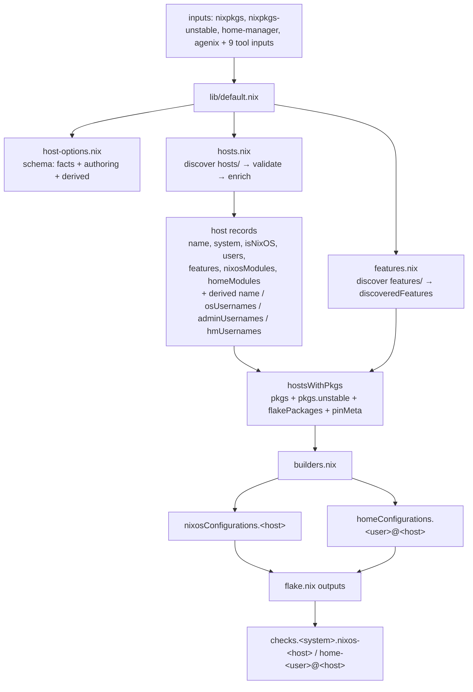
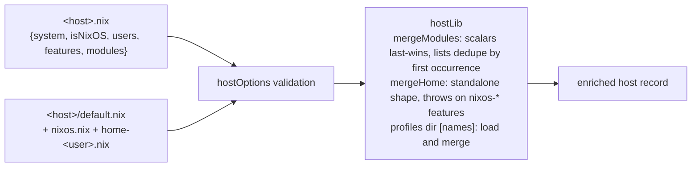
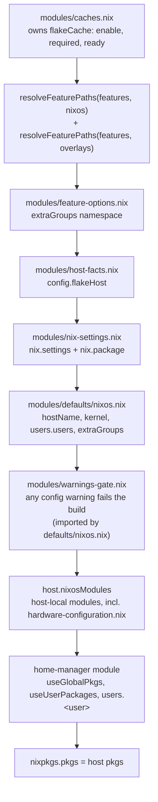
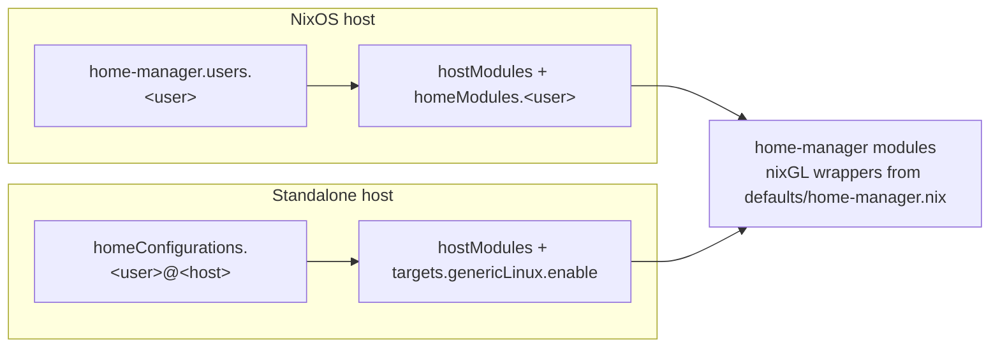
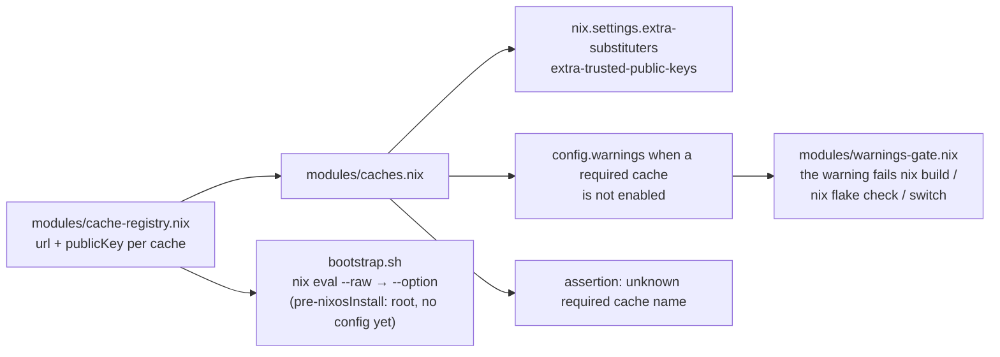
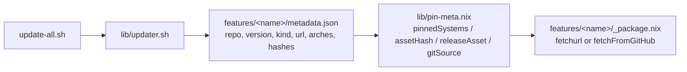
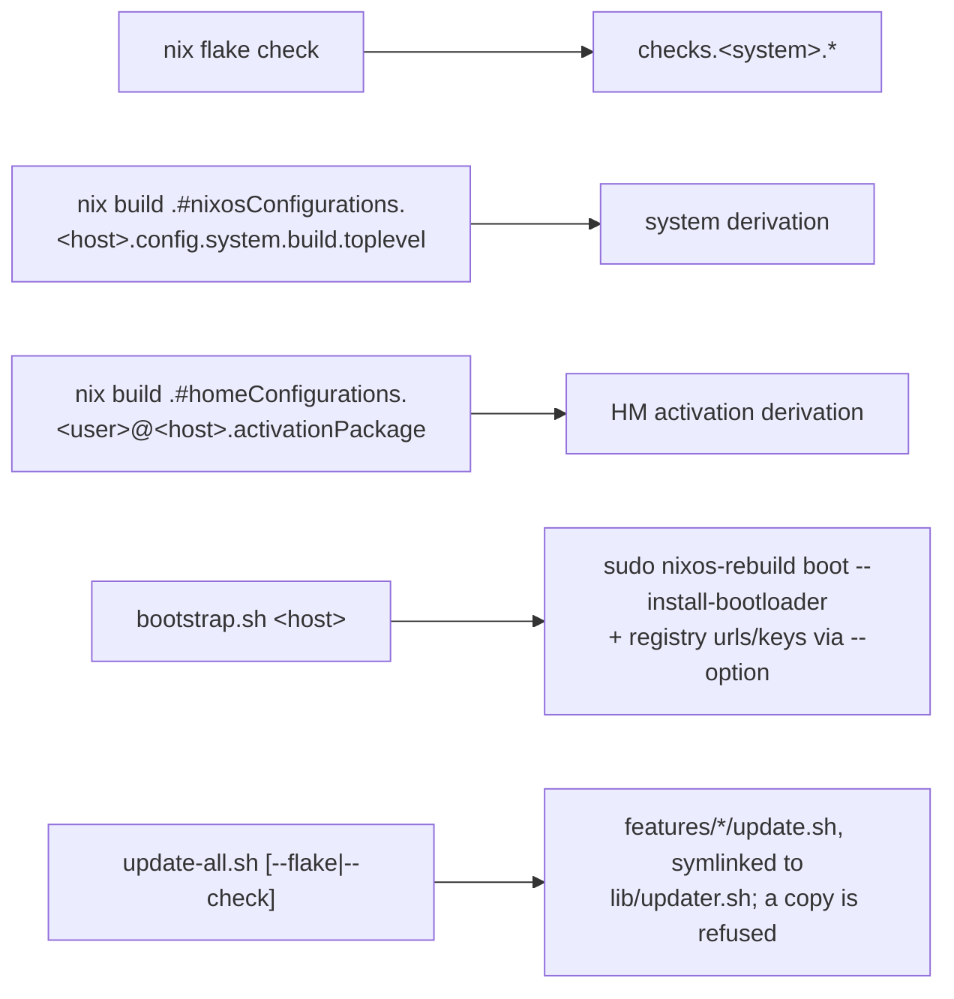
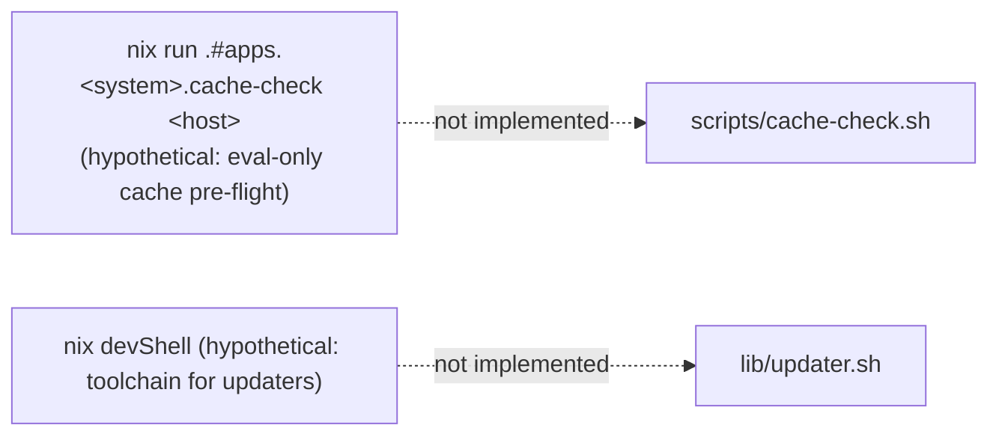

# DESIGN — Architecture

Plain flake (no flake-parts). Everything the flake exposes is produced by `./lib`, which is
split by concern: discovery, validation, package sets, and config builders. Hosts and features
are data; the loader is the only place that knows how they combine.

## Layout

```
flake.nix          # outputs only: nixosConfigurations, homeConfigurations, checks
lib/               # pure loader, one concern per file
  default.nix      #   composition root: wires the files below, builds one pkgs per host
  host-options.nix #   host record schema (facts / authoring / derived, split by ownership)
  hosts.nix        #   discovery + validation + enrichment
  host-lib.nix     #   host-facing composition: mergeModules, mergeHome, profiles
  features.nix     #   feature discovery + resolveFeaturePaths (unknown feature = throw)
  builders.nix     #   nixosSystem / homeManagerConfiguration, module order
  filesystems.nix  #   mkMounts / mkUnitMounts (subvolume -> mount + automount units;
                   #   automount = true adds the lazy .automount unit, skipIfMissing conditions
                   #   on the device) / joinUnitMounts (concat groups, never //)
                   #   / unitName (where -> unit name, exported so consumers and tests
                   #   name a unit exactly the way mkUnitMounts does)
  pin-meta.nix     #   metadata.json contract: pinnedSystems, assetHash, releaseAsset, gitSource
  updater.sh       #   generic pin updater; features symlink it to their own update.sh
modules/           # NixOS/HM modules the loader always imports
  cache-registry.nix caches.nix feature-options.nix host-facts.nix nix-settings.nix
  warnings-gate.nix defaults/{nixos,home-manager}.nix packages/pyz-wrapper.nix
features/<name>/   # nixos.nix, home.nix, optional _overlays.nix; private helpers are _*.nix
hosts/             # host records: <name>.nix or <name>/ (nixos.nix + home-<user>.nix)
                   #   methyl (KDE gaming) · methyl-nixos (GNOME; niri-spicy on,
                   #   libvirtd off, spice-vdagent as a guest) · propyl (T2 laptop)
                   #   methyl-bazzite (standalone HM) · methyl-base/ (shared records + profiles,
                   #   not a host: no default.nix)
tests/             # eval-only suite (see TEST_DESIGN.md); nix-eval.sh caps each eval in RAM
bootstrap.sh       # day-zero switch: cache urls/keys via --option, then switch
update-all.sh      # feature updaters, then flake input bumps
```

39 features: 12 home-only, 18 NixOS-only, 9 with both a `home.nix` and a `nixos.nix`;
2 carry an `_overlays.nix` (`nixos-cachyos`, `nixos-niri`).

## Loader pipeline



`supportedSystems` is derived from the configurations themselves
(`config.pkgs.stdenv.hostPlatform.system`), so a host targeting a system we do not check cannot
hide behind a missing check.

## Host authoring ergonomics

Host files are records, not modules. They are validated against the schema, so an unsupported
field is an error naming the option, and a derived field cannot be authored.



Feature lists are the single source of truth: `features = ["nixos-niri" "hm-tmux"]` resolves to
`features/nixos-niri/nixos.nix` and `features/hm-tmux/home.nix`. A name with no module for the
platform contributes nothing; a name that does not exist throws at evaluation with the available
list. Listing two kernel-pinning features (`nixos-cachyos`, `nixos-kait2en`) also throws — both
write `boot.kernelPackages` at `mkDefault`, and the module system would only report "defined
multiple times" with no host name.

Hosts are composed from shared records rather than duplicated: `hosts/methyl-base/{core,base,
graphical,gaming,extras,nixos-defaults}.nix` plus `hosts/methyl-base/profiles/` chain through
`hostLib.mergeModules` (`methyl-kde → methyl-gaming → methyl-common → core/base/graphical`).
Discovery also accepts symlinked feature dirs, symlinked host files and symlinked module files,
because `readDir` reports `"symlink"` for a checkout pointing at another tree.

## NixOS module composition (order matters)



Caches come first because feature modules gate on `config.flakeCache.enable` — e.g. `nixos-niri`
swaps niri for the spicy build only when its cache is substituted from. `modules/defaults/nixos.nix`
adds the warnings gate, sets `nix.extraOptions = "fallback = true"` (substitute when a cache serves
the path, build it ourselves only when it does not) and pins the default kernel at
`mkOverride 1100`, so a kernel feature's `mkDefault` still wins while a host's plain assignment
overrides both. Feature overlays are
modules that set `nixpkgs.overlays`, so they are appended to the pinned set at eval time and can
be gated on options; host `pkgs` is threaded in last so a host can pin its own package set.

## Home Manager composition



`useGlobalPkgs` means Home Manager shares the host package set, so gated overlays reach user
packages too; Home Manager modules must not set `nixpkgs.overlays`.

## Cache chain



## Pin metadata

Three features are metadata-backed today (`hm-brave`, `hm-tmux`, `hm-zed`); each carries a
`metadata.json` and a symlink to `lib/updater.sh` as its own `update.sh`
(`update-all.sh` refuses a copy; `lib/updater.sh --install features/<name>` creates both). The template is expanded twice — once in Nix
(`lib/pin-meta.nix releaseAsset`, at eval) and once in bash (`render_url`, at fetch) —
and `tests/run.sh` diffs the two byte-for-byte for every pin and pinned system.



`pinMeta` and `flakePackages` are injected into every package set by `lib/default.nix` — one set
per _system_, not per host, since every host here is x86_64-linux — so a feature reads them like a
build dependency rather than threading arguments. Feature overlays are not baked into that set:
they arrive as `nixpkgs.overlays` modules, appended at eval time.

## Input boundary

The lock carries seven nixpkgs trees (ours ×2, plus beryl-utils, kait2en, niri-spicy,
nix-cachyos-kernel, xilo). None uses `follows`, and that is the boundary: forcing one to follow
ours would evaluate it against a rev its CI never built, so every path it publishes from its own
cache stops matching — the CachyOS and KaiT2en kernels would rebuild locally, on the host with
the least RAM. The caches named in `modules/cache-registry.nix` are the same story: each is
somebody else's build of their own rev, so nothing here may repin them.

## User-facing ergonomics

Currently exposed:



Placeholders for ergonomics we do **not** implement yet (no `packages`, `devShell`, or `apps`
output today):


