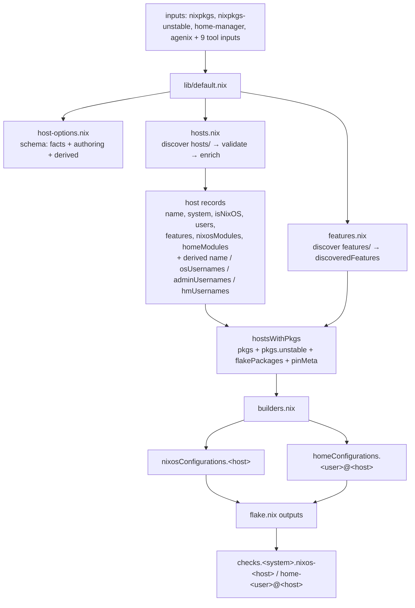
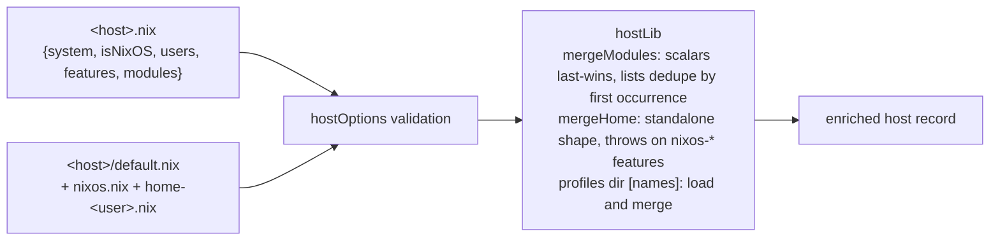
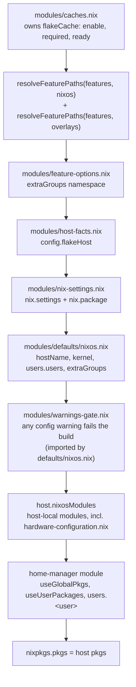
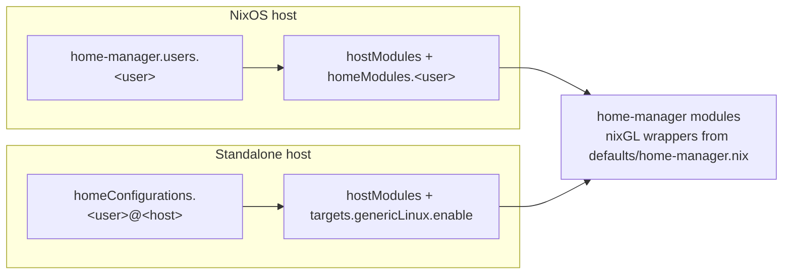
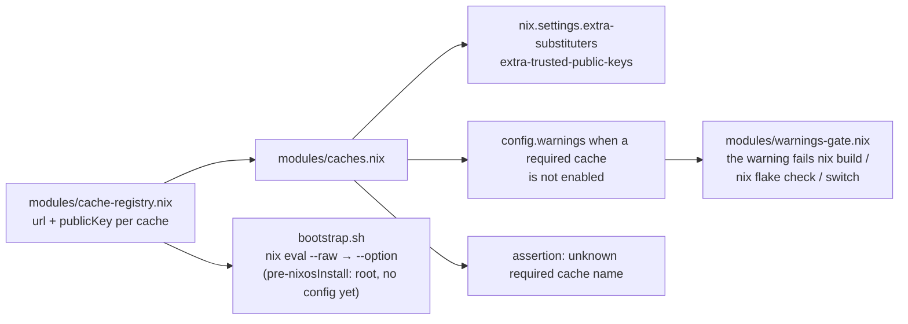
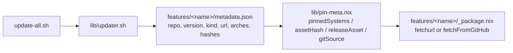
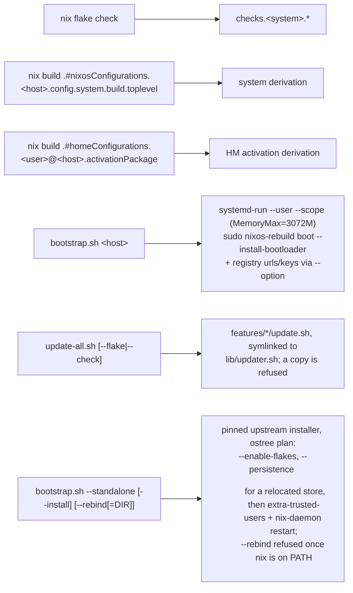
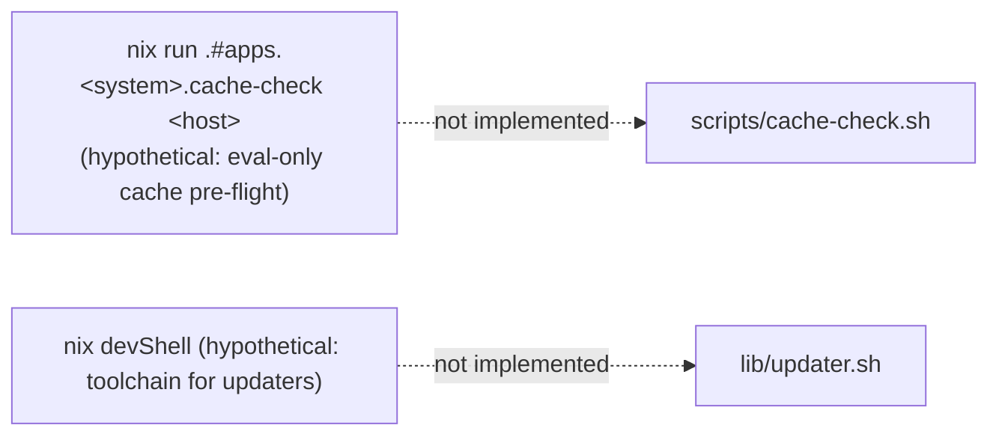

# DESIGN — Architecture

Plain flake (no flake-parts). Everything the flake exposes is produced by `./lib`, which is
split by concern: discovery, validation, package sets, and config builders. Hosts and features
are data; the loader is the only place that knows how they combine.

## Layout

```
flake.nix          # outputs only: nixosConfigurations, homeConfigurations, checks
lib/               # pure loader, one concern per file
  default.nix      #   composition root: wires the files below, builds one pkgs per host
  host-options.nix #   host record schema (facts / authoring / derived, split by ownership)
  hosts.nix        #   discovery + validation + enrichment
  host-lib.nix     #   host-facing composition: mergeModules, mergeHome, profiles
  features.nix     #   feature discovery + resolveFeaturePaths (unknown feature = throw)
  builders.nix     #   nixosSystem / homeManagerConfiguration, module order
  filesystems.nix  #   mkMounts / mkUnitMounts (subvolume -> mount + automount units;
                   #   automount = true adds the lazy .automount unit, skipIfMissing conditions
                   #   on the device) / joinUnitMounts (concat groups, never //)
                   #   / unitName (where -> unit name, exported so consumers and tests
                   #   name a unit exactly the way mkUnitMounts does)
  pin-meta.nix     #   metadata.json contract: pinnedSystems, assetHash, releaseAsset, gitSource
  updater.sh       #   generic pin updater; features symlink it to their own update.sh
modules/           # NixOS/HM modules the loader always imports
  cache-registry.nix caches.nix feature-options.nix host-facts.nix nix-settings.nix
  warnings-gate.nix defaults/{nixos,home-manager}.nix packages/pyz-wrapper.nix
features/<name>/   # nixos.nix, home.nix, optional _overlays.nix; private helpers are _*.nix
hosts/             # host records: <name>.nix or <name>/ (nixos.nix + home-<user>.nix)
                   #   methyl (KDE gaming) · methyl-nixos (GNOME; niri-spicy on,
                   #   libvirtd off, spice-vdagent as a guest) · propyl (T2 laptop)
                   #   methyl-bazzite (standalone HM) · methyl-base/ (shared records + profiles,
                   #   not a host: no default.nix)
tests/             # eval-only suite (see TEST_DESIGN.md); nix-eval.sh caps each eval in RAM
bootstrap.sh       # day-zero switch: cache urls/keys via --option, then switch
update-all.sh      # feature updaters, then flake input bumps
```

39 features: 12 home-only, 18 NixOS-only, 9 with both a `home.nix` and a `nixos.nix`;
2 carry an `_overlays.nix` (`nixos-cachyos`, `nixos-niri`).

## Loader pipeline



`supportedSystems` is derived from the configurations themselves
(`config.pkgs.stdenv.hostPlatform.system`), so a host targeting a system we do not check cannot
hide behind a missing check.

## Host authoring ergonomics

Host files are records, not modules. They are validated against the schema, so an unsupported
field is an error naming the option, and a derived field cannot be authored.



Feature lists are the single source of truth: `features = ["nixos-niri" "hm-tmux"]` resolves to
`features/nixos-niri/nixos.nix` and `features/hm-tmux/home.nix`. A name with no module for the
platform contributes nothing; a name that does not exist throws at evaluation with the available
list. Listing two kernel-pinning features (`nixos-cachyos`, `nixos-kait2en`) also throws — both
write `boot.kernelPackages` at `mkDefault`, and the module system would only report "defined
multiple times" with no host name.

Hosts are composed from shared records rather than duplicated: `hosts/methyl-base/{core,base,
graphical,gaming,extras,nixos-defaults}.nix` plus `hosts/methyl-base/profiles/` chain through
`hostLib.mergeModules` (`methyl-kde → methyl-gaming → methyl-common → core/base/graphical`).
Discovery also accepts symlinked feature dirs, symlinked host files and symlinked module files,
because `readDir` reports `"symlink"` for a checkout pointing at another tree.

## NixOS module composition (order matters)



Caches come first because feature modules gate on `config.flakeCache.enable` — e.g. `nixos-niri`
swaps niri for the spicy build only when its cache is substituted from. `modules/defaults/nixos.nix`
adds the warnings gate, sets `nix.extraOptions = "fallback = true"` (substitute when a cache serves
the path, build it ourselves only when it does not) and pins the default kernel at
`mkOverride 1100`, so a kernel feature's `mkDefault` still wins while a host's plain assignment
overrides both. Feature overlays are
modules that set `nixpkgs.overlays`, so they are appended to the pinned set at eval time and can
be gated on options; host `pkgs` is threaded in last so a host can pin its own package set.

## Home Manager composition



`useGlobalPkgs` means Home Manager shares the host package set, so gated overlays reach user
packages too; Home Manager modules must not set `nixpkgs.overlays`.

## Cache chain



## Pin metadata

Four features are metadata-backed today (`hm-brave`, `hm-ghostty`, `hm-tmux`, `hm-zed`); each carries a
`metadata.json` and a symlink to `lib/updater.sh` as its own `update.sh`
(`update-all.sh` refuses a copy; `lib/updater.sh --install features/<name>` creates both). The template is expanded twice — once in Nix
(`lib/pin-meta.nix releaseAsset`, at eval) and once in bash (`render_url`, at fetch) —
and `tests/run.sh` diffs the two byte-for-byte for every pin and pinned system.



`pinMeta` and `flakePackages` are injected into every package set by `lib/default.nix` — one set
per _system_, not per host, since every host here is x86_64-linux — so a feature reads them like a
build dependency rather than threading arguments. Feature overlays are not baked into that set:
they arrive as `nixpkgs.overlays` modules, appended at eval time.

An asset pin may be a binary upstream never ships: `hm-ghostty` pins the pkgforge Ghostty
AppImage and its `_package.nix` unpacks it (`--appimage-extract`) into the store as an AppDir —
static launcher, bundled libs, and the resource trees Home Manager's `programs.ghostty` reads
(`share/ghostty`, `share/terminfo`, `share/bat`, `share/glib-2.0/schemas`, `share/systemd/user`,
`share/dbus-1/services`). Nothing is compiled and nothing is patchelf'd; the launcher resolves its
own AppDir from `/proc/self/exe` and exports the resource and driver search paths from there, so
the only dependency injected at runtime is GPU drivers, via `config.lib.nixGL.wrapGpu`. The
AppDir's desktop entry and icon are moved to `share/applications` and `share/icons/hicolor`, which
is where Home Manager's profile (`~/.nix-profile/share`, already on `XDG_DATA_DIRS`) surfaces them
for app launchers and `update-desktop-database`; the entry's `Exec=ghostty` resolves through the
profile's `bin`, the same way `home.packages` puts the binary on `PATH`.

Every feature that ships a prebuilt binary calls one helper, `config.lib.nixGL.wrapGpu`
(`modules/defaults/home-manager.nix`), and each side of the disable is explicit: it is identity when
Home Manager has no nixGL namespace, and identity when `targets.genericLinux.nixGL.packages` is null
(Home Manager's own wrapper is a no-op on null, which is the shape a NixOS host has). When the wrap
does happen it delegates to Home Manager's `lib.nixGL.wrap`, which picks
`wrappers.`${targets.genericLinux.nixGL.defaultWrapper}`— so the driver set follows the host rather
than a hardcoded Mesa:`features/hm-nixgl`declares`features.nixgl.wrapper` (`mesa`by default;`nvidia`/`nvidiaPrime`on an Nvidia host, which needs the config built with`--impure`and has not
been run on a box with an Nvidia GPU).`features/hm-nixgl`supplies packages only when`flakeHost.isNixOS` is false — on NixOS the system already provides GL/EGL/drivers, and setting
packages there would pull foreign Mesa into the closure. The three callers (`hm-brave`, `hm-zed`, `hm-ghostty`) install through their program module
(`programs.chromium`installs`finalPackage`, `programs.zed-editor`installs`package`,
`programs.ghostty`installs`package`), so none of them adds a second copy to `home.packages`.
`hm-brave`takes`commandLineArgs`because`programs.chromium`overrides its package whenever`features.brave-browser.passwordStore` is set; with no flags its bin entries stay plain symlinks.

## Input boundary

The lock carries seven nixpkgs trees (ours ×2, plus beryl-utils, kait2en, niri-spicy,
nix-cachyos-kernel, xilo). None uses `follows`, and that is the boundary: forcing one to follow
ours would evaluate it against a rev its CI never built, so every path it publishes from its own
cache stops matching — the CachyOS and KaiT2en kernels would rebuild locally, on the host with
the least RAM. The caches named in `modules/cache-registry.nix` are the same story: each is
somebody else's build of their own rev, so nothing here may repin them.

## Build RAM

Evaluation, not the builder, is what a host build costs here (measured through
`tests/nix-eval.sh`, Determinate Nix 3.21.7 — see "Which evaluator" below for the per-evaluator
numbers): a host's `system.build.toplevel.drvPath` peaks at
~2.1GB and a standalone profile's `activationPackage.drvPath` at ~1.4GB, and almost all of it is
the configuration's own module evaluation — forcing `config.warnings` alone peaks at ~2.0GB. On a
RAM-constrained host a plain `nixos-rebuild switch` can therefore swap or be OOM-killed mid-eval.

Run host builds inside a transient scope, so the limit kills the process instead of thrashing.
`bootstrap.sh` does this for its own rebuild; anything run by hand takes the same shape:

```bash
systemd-run --user --scope --unit="rebuild-$$.scope" \
  -p MemoryHigh=2600M -p MemoryMax=3072M -p MemorySwapMax=1024M \
  sudo nixos-rebuild switch --flake .#<host>
```

The cap is 3072 rather than 2560 because the cold methyl eval measured 2365MB: 2560 leaves ~195MB
of headroom, and a colder run would be killed. `MemoryHigh` throttles and reclaims before the hard
cap, and `MemorySwapMax` halves the cap so a spill stays bounded instead of filling the swap device.
The unit name carries the pid because a scope killed by OOM stays `failed` in systemd's unit table
and a second `--unit` with the same name refuses with "already loaded".

The build itself is not bounded here: realisation runs in the root `nix-daemon`, outside the scope
(measured ~1.15GB throughout). Bounding that needs a daemon drop-in with `MemoryMax`, which this
flake does not install.

The eval gate's cap (1792MB in `tests/run.sh`) bounds the suite, not a build — it is below a host
build's eval. `flake.nix` reads check systems off the host records instead of forcing every
configuration's `config.pkgs`, which keeps naming the checks at ~15MB rather than ~510MB.

`rebuild-gate.sh` measures this instead of guessing it: one scoped nix command per target, the
scope's peak (the eval cost, since evaluation happens in the client process the scope runs) and
`nix-daemon.service`'s peak (the realisation cost, which no flag here bounds), plus what the
dry-run says about fetches vs builds. Numbers are appended to `.pi/rebuild-gate.jsonl`, one object
per phase, so two sessions can be diffed. `--cold` bypasses Nix's eval cache:

```bash
rebuild-gate.sh -m plan -c 4096 --cold   # this flake's toplevels and activation packages
```

Measured cold on this box: methyl 2365MB/13s, methyl-nixos 2261MB/23s, propyl 2284MB/12s, the
standalone activation package 1325MB/8s, with the daemon holding ~1.15GB throughout. A 2048MB cap
let the methyl eval through at 1845MB — close enough to the limit that a colder run can be killed,
which is why the scope is 3072MB.

The eval cache is not a lever for a NixOS config: warming it moved methyl to 2364MB/12s against
2363MB/13s cold. It helps flake metadata and cheap attributes, not module evaluation, so neither
`bootstrap.sh` nor a rebuild passes `--no-eval-cache` — there is nothing to save.

`-m probe` attributes that RAM instead of guessing it: `-t` is a config expression and each `-e` is
one attribute forced in its own scoped process. For methyl the spine (module evaluation alone,
`.config.system.stateVersion`) is 229MB, the installed package list
(`.config.environment.systemPackages`) is 1475MB, `.config.warnings` is 2067MB and the toplevel is
2363MB — so ~1.25GB is the closure of packages the host actually installs. Disabling every enabled
feature one at a time moved the toplevel peak by under 40MB, which is why no feature trimming is
proposed here. For the standalone profile the spine is 200MB, HM's warnings 202MB, the activation
package 1324MB, and the wrapped Ghostty package alone 446MB.

```bash
rebuild-gate.sh -m probe -c 3000 --cold \
  -t '(builtins.getFlake (toString ./.)).outputs.nixosConfigurations.methyl' \
  -e '.config.system.stateVersion' -e '.config.environment.systemPackages' \
  -e '.config.system.build.toplevel.drvPath'
```

### More cores, same RAM

Measured on this box (3 cores, ~4.6GB free):

| what                                                      | peak   | swap   | wall         |
| --------------------------------------------------------- | ------ | ------ | ------------ |
| one host config, cold, `eval-cores 0`                     | 2363MB | 0MB    | 13s          |
| all three configs in one expression, cold, `eval-cores 0` | 3063MB | 1000MB | 37s          |
| the same, `eval-cores 4`                                  | 3063MB | 729MB  | 32s          |
| two `nix-eval-jobs` processes side by side, cold          | 4743MB | 2048MB | 21s (killed) |
| the same pair with the eval cache warm                    | 3807MB | 1500MB | 17s (killed) |

- `--workers` above 1 is not affordable here. Each `nix-eval-jobs` worker is a separate Nix
  process, so it cannot share the evaluated nixpkgs or the eval cache with its sibling — the warm
  pair still cost 3.8GB. ([Discourse](https://discourse.nixos.org/t/parallel-evaluation-comes-to-determinate-nix/68934)
  reports the same for a multi-config CI flake.)
- `workers * max-memory-size` is one budget for all workers combined, not per-worker headroom:
  jobs are dispatched only while total RSS plus the estimated growth of in-flight jobs fits it, and
  a worker over its share is restarted. Our configs need ~2.4GB each, so the README's rule of thumb
  — fewer workers with a larger share when a single attribute exceeds one share — is what this flake
  wants one worker. "What to run" below is why this flake runs one target per process instead.
- Cores are available for free _inside_ one process: Determinate's
  [parallel evaluation](https://determinate.systems/blog/parallel-nix-eval) shares a single
  evaluator heap, so `--option eval-cores 4` cost the same 3063MB and saved 5s. A NixOS toplevel is
  mostly a serial thunk chain, so the win is ~13% rather than the 4x reported for `nix flake show`.
- One expression holding every config is the _higher_-memory shape (3063MB vs 2363MB for one at a
  time, same wall time). One target per process is what `nixos-rebuild` and `-m probe` do.

### Which evaluator

Same attribute (methyl's toplevel), three evaluators, each run directly inside the scope, cap
3000MB so swap stayed 0. Determinate 3.21.7 wraps Nix 2.34.8; the Lix CLI here is 2.95.4:

| evaluator                           | one config       | all configs in one process               | cheap suite |
| ----------------------------------- | ---------------- | ---------------------------------------- | ----------- |
| upstream Nix 2.34.9 (`nixpkgs#nix`) | **1712MB / 10s** | **3062MB / 29s** (swap 573MB)            | 10-55MB     |
| Determinate Nix 3.21.7              | 2363MB / 12s     | 3063MB / 37s cold, 32s at `eval-cores 4` | 16-48MB     |
| Lix 2.95.4 CLI                      | 2163MB / 11s     | 4204MB / 55s (swap 1699MB)               | 0-10MB      |

Upstream wins both axes on this flake: ~650MB less per config than Determinate and ~1.1GB less on a
bulk eval, at the lowest wall time. Determinate's extras (lazy trees, eval cache, parallel-eval) do
not buy the RAM back here. NixOS hosts get upstream by default (`modules/nix-settings.nix` sets
`nix.package = lib.mkDefault pkgs.nix`) and no host overrides it: the `nixos-lix` feature was deleted
after this measurement, and `tests/configs.nix` asserts `nix.package.pname == "nix"` on every host
so it cannot come back.

### What to run

Every prospective host, one attribute each, scoped at 2560MB (`MemoryHigh=2304MB`,
`MemorySwapMax=1280MB`) through `tests/build-harness.sh`:

| host                       | `nix build --dry-run` (what `njust` runs) | `nix-eval-jobs`, now removed |
| -------------------------- | ----------------------------------------- | ---------------------------- |
| methyl                     | **1698MB / 0MB swap / 22s**               | 2306MB / 1047MB swap / 18s   |
| methyl-nixos               | 1556MB / 0MB / 15s                        | 2305MB / 680MB / 16s         |
| propyl                     | 1488MB / 0MB / 9s                         | 2304MB / 783MB / 17s         |
| josh@methyl-bazzite (home) | 980MB / 0MB / 6s                          | 1832MB / 0MB / 9s            |

The strategy this flake follows:

- **One closure: plain `nix` / `nixos-rebuild`, scoped.** Upstream Nix is the lightest evaluator
  measured here ("Which evaluator" above). The fast clients were culled on the numbers above: the
  Lix-linked evaluator keeps a flat ~2.3GB floor whatever the host and spills 0.7–1.0GB into swap
  under the cap, saving ~4s on methyl and running _slower_ on propyl (17s against 9s).
  `nix-fast-build` delegated to it and inherited the cost, and neither tool activates a system
  generation, so a rebuild needs `nixos-rebuild` regardless. `nix.just` therefore runs `nix build`,
  `nixos-rebuild`, and `home-manager switch`, and `features/hm-njust/home.nix` no longer installs
  `pkgs.nix-fast-build` / `pkgs.nix-eval-jobs`. `bootstrap.sh` uses `nixos-rebuild` inside a scope
  and nothing else.
- **One attribute per process.** A single expression holding every config is the higher-memory shape
  ("More cores, same RAM"), and `nix-fast-build`'s pipelining was never affordable here: each worker
  is a separate Nix process, so a pair cost 4.7GB cold.
- Parallel evaluation is Determinate-only — `eval-cores` and `parallel-eval.cc` are not in
  [NixOS/nix](https://github.com/NixOS/nix) or [Lix](https://github.com/lix-project/lix), whose
  evaluator stays single-threaded (upstream multi-threaded eval,
  [NixOS/nix#8711](https://github.com/NixOS/nix/pull/8711), regresses and is unmerged) — so there is
  nothing to configure on this flake's upstream Nix. `eval-cache` is universal and defaults to
  `true`.
- `GC_INITIAL_HEAP_SIZE=2G` (what `nix.just`'s dry-run sets) is not a RAM hammer: 2362MB with it
  against 2375MB without, swap 0 both ways. Boehm reserves address space and only faults pages it
  actually uses.

## User-facing ergonomics

Currently exposed:



`bootstrap.sh --standalone` is the host-side bootstrap for a machine that is not NixOS. It runs the
pinned upstream installer with the **`ostree` plan** (the plan for immutable root filesystems),
`--enable-flakes`, and `--persistence <dir>` when `--rebind` names the volume the store should live
on — the installer owns the `/nix` bind mount, so this repo writes no `nix.mount` unit. It then
appends `extra-trusted-users` for the invoking user, because caches injected with `--option` are
ignored for an untrusted user, and re-checks `nix store info` after the daemon restart so a trust
step that did not take effect cannot report success.

It installs only when `nix` is not on PATH, and `--rebind` is refused past that point — the store
bind only happens while the installer is running, so a flag that could silently do nothing is
refused instead. A box that already has Determinate Nix is cleared by hand first, through
Determinate's own uninstaller, which records its actions in `/nix/receipt.json`
(including the `/nix` mount it created):

```bash
sh <(curl -s https://install.determinate.systems/nix) uninstall
./bootstrap.sh --standalone --install josh@bazzite
```

The gate checks this behaviour through `tests/bootstrap.bats` (stubs, no root), not through Nix eval.

Placeholders for ergonomics we do **not** implement yet (no `packages`, `devShell`, or `apps`
output today):


