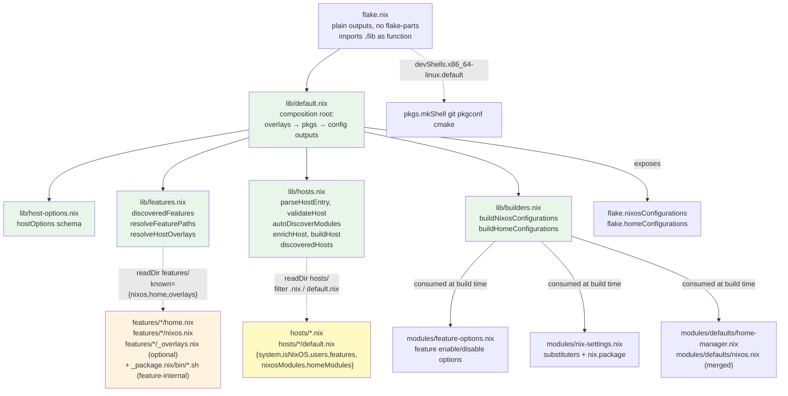
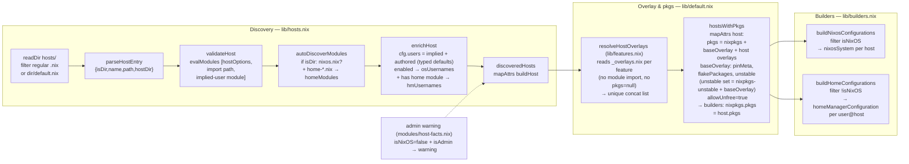
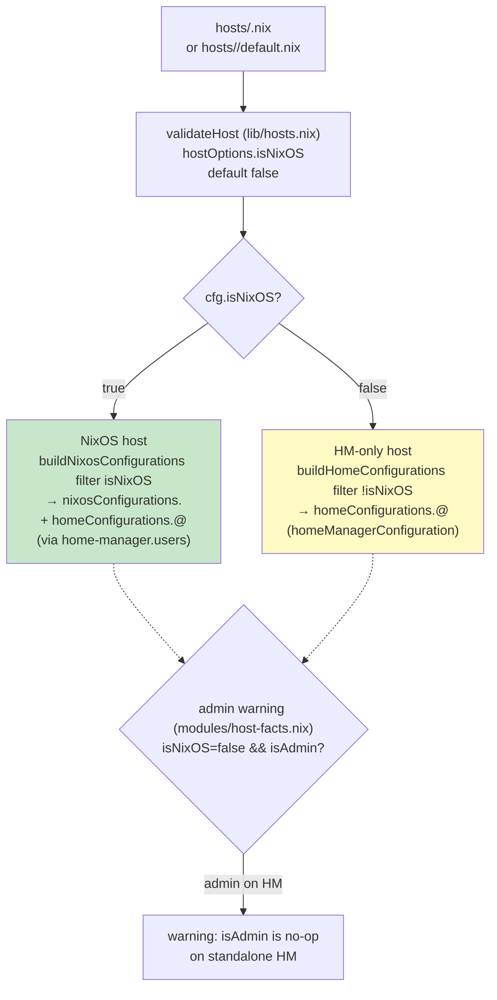
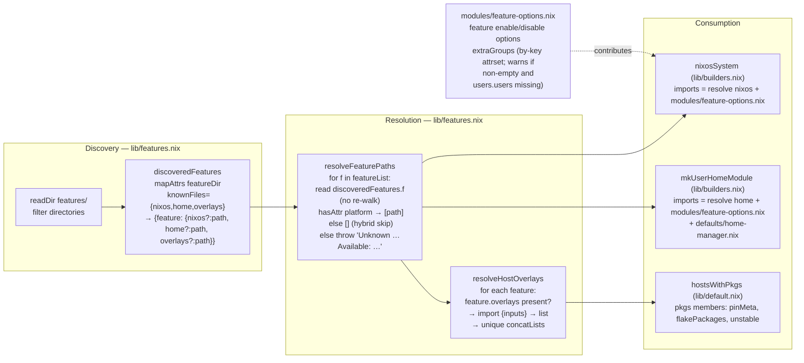
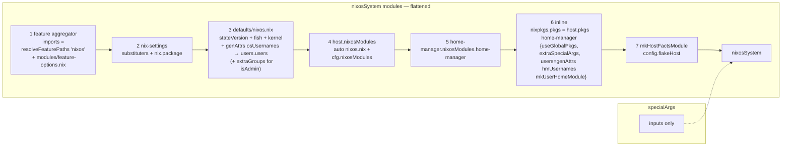
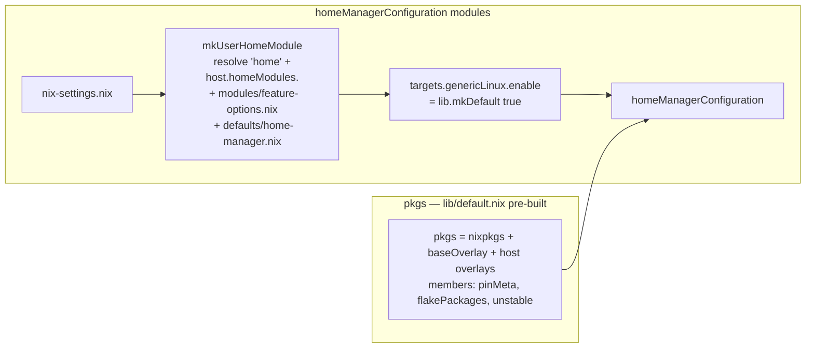
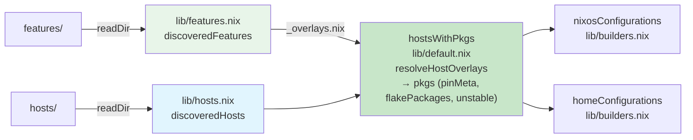

# DESIGN — Architecture & Dependencies

## File Layout

```
flakeroot/
├── flake.nix                       # plain outputs (no flake-parts), imports ./lib
├── lib/                            # pure lib, split by concern
│   ├── default.nix                 #   composition root — re-exports all concern files
│   ├── host-options.nix            #   hostOptions schema
│   ├── features.nix                #   feature discovery + _overlays.nix resolution
│   ├── pin-meta.nix                #   metadata.json pin contract (releaseAsset/gitSource/pinnedSystems, one `pinMeta` member)
│   ├── hosts.nix                   #   host discovery + validation + enrichment
│   └── builders.nix                #   nixosSystem / homeManagerConfiguration builders
├── hosts/                          # per-host declarations (auto-discovered)
│   ├── methyl-bazzite.nix          # HM-only flat host
│   ├── methyl/                     # NixOS host (bare metal)
│   │   ├── default.nix             #   {system,isNixOS,users,features}
│   │   ├── base.nix                #   shared NixOS config (no hw import)
│   │   ├── nixos.nix               #   host wrapper: hw-config + base
│   │   ├── home-josh.nix           #   per-user HM module
│   │   └── hardware-configuration.nix
│   ├── methyl-nixos/               # NixOS host (QEMU VM — reuses methyl/)
│   │   ├── default.nix
│   │   ├── nixos.nix
│   │   ├── home-josh.nix           #   re-imports ../methyl/home-josh.nix
│   │   └── hardware-configuration.nix
│   └── propyl/                     # NixOS host (MacBookPro16,2 / T2 POC — reuses methyl/)
│       ├── default.nix             #   methyl facts + narrowed features (+ nixos-kait2en)
│       ├── base.nix                #   loader/ssh/oomd, authored on top of the hw-config
│       ├── nixos.nix               #   host wrapper: hw-config + base
│       ├── home-josh.nix           #   stub: its own env, methyl's niri/dms options are absent
│       └── hardware-configuration.nix  # placeholder in generated-file shape
├── features/                       # 40 composable units, auto-discovered
│   ├── hm-only    (14)             #   home.nix only
│   ├── nixos-only (18)             #   nixos.nix only
│   ├── hybrid      (8)             #   home.nix + nixos.nix: hm-syncthing, nixos-dmemcg, nixos-dms, nixos-flatpak, nixos-kde, nixos-lsfg, nixos-niri, nixos-oom
│   ├── _overlays.nix               #   optional: {inputs, ...}: [ … ] per feature
│   └── extras                      #   _package.nix / _*.nix / bin/ / *.sh imported by the feature itself
├── modules/
│   ├── bootstrap.nix               # swapfile+zswap for /etc/nixos/swap-prepare.nix (bootstrap.sh)
│   ├── nix-settings.nix            # substituters, trusted keys, nix.package
│   ├── defaults/
│   │   ├── home-manager.nix        # stateVersion, manual off, nixGL wrapMesa default
│   │   └── nixos.nix               # stateVersion, fish, kernel + genAttrs osUsernames → users.users (+ extraGroups)
│   └── packages/
│       └── pyz-wrapper.nix         # generic .pyz fetcher (gamemode, etc.)
├── bootstrap.sh
├── flake.nix / flake.lock
└── DESIGN.md / README.md
```

Feature file convention: `home.nix` → HM platform, `nixos.nix` → NixOS platform. Extras (`_package.nix`, `_*.nix`, `bin/`, `*.sh`) are imported by the feature's own entry point, not discovered.

---

## Module Dependency Graph

Static `imports` vs. runtime `readDir`/`import`.



`lib/` files have no `options`/`config` at top level — pure functions. `lib/default.nix` is the sole impure wiring layer (`readDir`, `import`, `evalModules` for host validation only). `nix-settings.nix` and `defaults/*` are not statically imported by `lib/default.nix`; they are injected by the `buildNixosConfigurations`/`buildHomeConfigurations` builders in `lib/builders.nix`.

---

## Build Pipeline

Evaluation order in `lib/default.nix` → concern files.



`hostsWithPkgs` computed once in `lib/default.nix` and shared by both builders — single overlay resolution per host.

---

## Host Type Resolution



`isQemuVM` and `bootstrap` (declared in `hostOptions`, `lib/host-options.nix`) are orthogonal — they don't affect host classification, only feature/overlay gating downstream.

---

## Feature System



A single walker owns discovery: `discoveredFeatures` is the one `readDir`, and `resolveFeaturePaths` resolves each listed feature against it (no second `pathExists` walk). Unknown feature throws with a sorted `Available:` list; a listed feature with no module for the requested platform resolves to `[]` (hybrid skip). Extras like `_package.nix`/`bin/*.pyz` are not discovered — the feature's own `home.nix`/`nixos.nix` imports them. `_overlays.nix` is part of the same discovery map (`knownFiles`), so `resolveHostOverlays` imports the discovered path — no second walk.

**Listing a feature means it is enabled.** Every top-level `features.<name>.enable` defaults to `true` (`mkEnableOption … // {default = true;}`), so a host only lists the features it wants on; `enable = false` is the opt-out, and any per-feature attrs are knobs (e.g. `oomd.notify`, `dms.niriCompat`, `niri.niri-watcher.enable`). Sub-knobs that are opt-in (e.g. `niri.kanshi.enable`) stay default-false.

---

## Configuration Composition

### NixOS Host — `buildNixosConfigurations` (`lib/builders.nix`)



`mkUserHomeModule` chain per user (`lib/builders.nix`): `resolve home` + `host.homeModules.<user>` + `modules/feature-options.nix` + `defaults/home-manager.nix` + `mkHostFactsModule host`. The builder sets `home.username` and `home.homeDirectory` (`mkDefault`). Nothing else is threaded: `pkgs` is a module value (`nixpkgs.pkgs`), and the host's unstable set is a member of it (`pkgs.unstable`).

### HM-Only Host — `buildHomeConfigurations` (`lib/builders.nix`)



---

## Data Flow Summary



---

## Key Design Decisions

| Decision                                     | Rationale                                                                                                                                                                                                                                                                                    |
| -------------------------------------------- | -------------------------------------------------------------------------------------------------------------------------------------------------------------------------------------------------------------------------------------------------------------------------------------------- |
| `lib/` directory (was single `lib.nix`)      | Split by concern: `host-options`, `features`, `hosts`, `builders`; `default.nix` is the composition root re-exporting the public surface                                                                                                                                                     |
| `hardware-configuration.nix` stays generated | The barrel imports it first and `base.nix` authors loader/ssh/services on top, so `nixos-generate-config` can overwrite the disk description with no config edits (methyl, methyl-nixos, propyl)                                                                                          |
| `isNixOS` bool                               | Explicit host classification; `false` default keeps HM-only hosts terse                                                                                                                                                                                                                      |
| `system` in host file                        | Single source of truth for `pkgs` system                                                                                                                                                                                                                                                     |
| Flat `hosts/<name>.nix` + directory hosts    | Simple hosts stay one file; complex hosts auto-discover `nixos.nix`/`home-*.nix`                                                                                                                                                                                                             |
| Feature dirs auto-discovered                 | No registry; add `features/foo/{home,nixos}.nix` and list `"foo"` in host — **listing = enabled** (`enable` defaults to `true`; `false` is the opt-out, per-feature attrs are knobs)                                                                                                         |
| `_overlays.nix` per feature                  | Features that need overlays ship `{inputs, ...}: [ … ]` in `_overlays.nix`; `resolveHostOverlays` imports it directly — no module eval, no `pkgs = null` sentinel
| `pinMeta` as one package-set member          | `metadata.json` pins share one shape contract, so `lib/pin-meta.nix` owns the URL template, system lookup, and arches/hash shape check; the whole attrset is one member of `baseOverlay`, present in every package set, so `callPackage` hands it to `_package.nix` as a build dependency (`pinMeta.releaseAsset pin system`) (feature `_overlays.nix` reaches `pkgs` only)                              |
| `baseOverlay` members: `pinMeta`, `flakePackages`, `unstable` | Flake inputs that publish `packages` land in the host set, so a flake package read in a feature module is a module value (`flakePackages.<name>.<system>.default`); `self` is excluded because a future `packages` output would point back at the host configs and cycle; the unstable set carries `baseOverlay` only, so `pkgs.unstable` never asks for itself |
| Hosts keyed by their own name (`lib/hosts.nix`) | `hosts/<name>.nix` and `hosts/<name>/default.nix` yield one key — `<user>@<host>` in `homeConfigurations` and `nixosConfigurations.<host>` — so every public output names a host the same way; two definitions resolving to one name throw at discovery |
| `flakeHost` as one option (`modules/host-facts.nix`) | Host facts reach modules through a single declared `config.flakeHost`, typed from the schema groups in `lib/host-options.nix` (`hostFacts`, `authoringOptions`, `derivedOptions` — no key list subtracted at runtime), so any host attribute the schema declares is a fact and an undeclared one is a type error instead of a silent default; `osUsernames`/`hmUsernames` derive from the typed `users` set, never written by a host |
| `networking.hostName = mkDefault config.flakeHost.name` (`modules/defaults/nixos.nix`) | Discovery owns the name: `lib/hosts.nix` takes it from the `hosts/` directory or file name and re-injects it after the host config merges, so a host file cannot override it and a new host costs no `hostName` line |
| `specialArgs = {inherit inputs;}` | Only the flake inputs stay injected: three features build module paths from them at import time (`inputs.agenix.homeManagerModules.default` is evaluated before the module system runs). Package sets and host facts are module values instead (`nixpkgs.pkgs`, its `unstable` member, `config.flakeHost`) |
| `hostsWithPkgs` in `lib/default.nix`         | Overlays resolved once, `pkgs` shared by both builders and reachable as `nixosConfigurations.<host>.pkgs` / `homeConfigurations.<user>@<host>.pkgs`; the loader keeps it internal because `nix flake check` warns on non-standard outputs and a public copy would drift from the configs                          |
| `modules/defaults/*` collapsed (2 files)     | `home-manager.nix` (stateVersion, manual off, the nixGL `wrapMesa` wrapper) + merged `nixos.nix` (stateVersion/shell/kernel + `users.users` + `extraGroups` for `isAdmin`); always-on, so consumers call `config.lib.nixGL.wrapMesa` without a fallback |
| `bootstrap` flag                             | Gates cache-dependent options during first deploy (`bootstrap.sh`)                                                                                                                                                                                                                           |
| `hmEnabled` per user                         | NixOS user exists without HM when `false`                                                                                                                                                                                                                                                    |
| `extraGroups` aggregation                    | Features declare groups as a **by-key attrset** (`extraGroups = { foo = ["grp"]; }`); the single consumer (`defaults/nixos.nix`) flattens `attrValues` for `isAdmin` users — no last-wins collision, no `lib.mkAppend` (absent in nixpkgs). Warns if non-empty and `users.users` unavailable |
| Plain `flake.nix` outputs (no `flake-parts`) | Single `x86_64-linux` system, `devShells.x86_64-linux.default` inline; removed framework tax (1 input, ~30 lock lines)                                                                                                                                                                       |
| Public outputs are the configs only          | `nixosConfigurations` + `homeConfigurations` (+ `devShells`) are the only exports: `features` was a public copy of a value the loader already has, and a package-set output would duplicate `<config>.pkgs`, so `nix flake check` reports no unchecked outputs and inspection reads one path                                                          |
