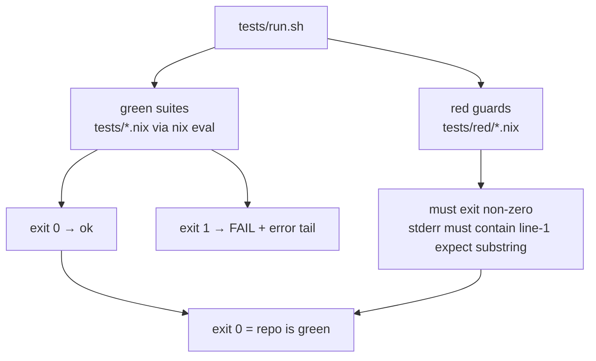
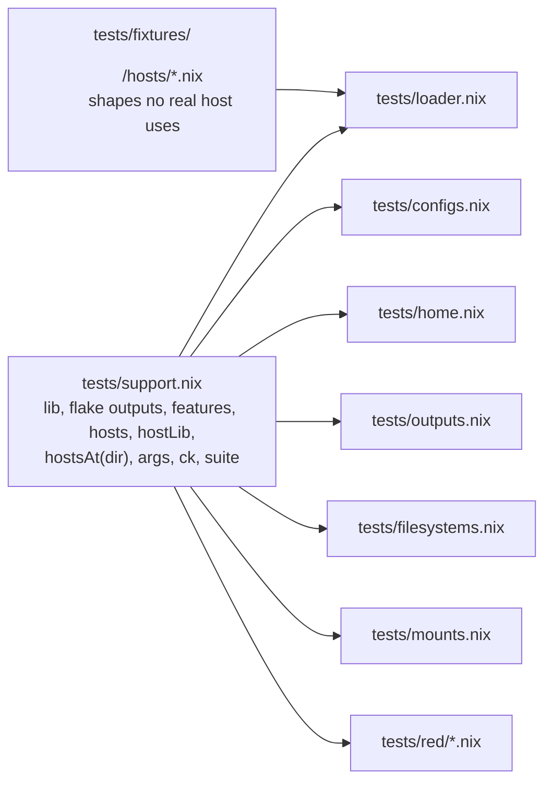
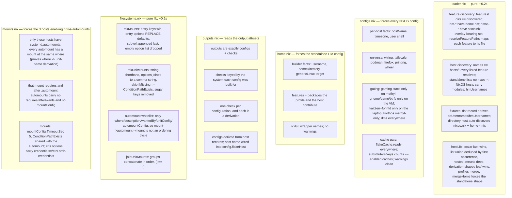
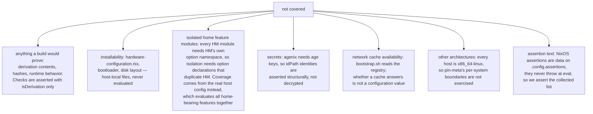

# TEST_DESIGN — eval-only suite

The suite asserts on **evaluated configuration values**, never on built output: `nix eval --impure
--file` forces a config far enough to read option values, and that is the whole cost. No `nix
build` runs, so the gate is fast and works without a store.

## Gate shape

Why two kinds of gate: Nix errors are deferred values, so `builtins.tryEval` cannot catch them.
A guard that must fail is a tiny file whose _exit status_ is the assertion; everything else is a
boolean check inside a suite. Fixture directories exist so loader guards never depend on a real
host changing shape.

## What each suite covers

```mermaid
flowchart LR
  subgraph red["red/*.nix — must throw"]
    R1["unknown feature name"]
    R2["two host files resolving to one name"]
    R3["host file written as a module instead of a record"]
    R4["host file authoring a derived name"]
    R5["mergeHome handed a nixos-* feature"]
    R6["a home configuration has no NixOS system"]
    R7["mkMounts options is a string, not a list"]
    R8["mkUnitMounts options is a string, not a list"]
    R9["mkMounts entry is a string, not an attrset"]
    R10["mkUnitMounts entry is a number, not an attrset"]
    R11["skipIfMissing without what (ConditionPathExists needs the device)"]
  end
```

Coverage rule: assert on **namespaces and values**, not on `enable` flags. A feature's option
defaults are unreliable evidence — several features ship packages without turning a program
option on — so checks look for the service, the package, or the kernel parameter the feature
actually produces.

## What we do not cover

Deliberately skipped: per-feature coverage of all 39 modules. Feature modules are exercised
through the hosts that enable them — 36 of 39 are enabled by at least one host, so they evaluate
and their effects are asserted. The three no host enables (`hm-dcal`, `nixos-cachyos`,
`nixos-zram`) have no test: a feature no host asks for is not a shipping contract. If one of them
becomes load-bearing, cover it by enabling it on a fixture host, not by isolating the module.
