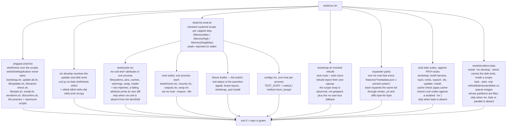
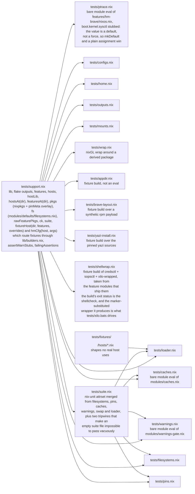
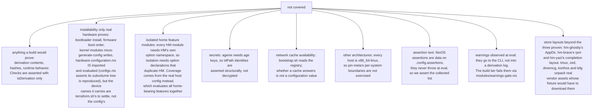

# TEST_DESIGN — eval-only suite

The suite asserts on **evaluated configuration values**, never on built output: `nix eval --impure
--file` forces a config far enough to read option values, and that is the whole cost. The
value-tier assertions — the shapes, the loader contracts and everything that must throw — are
`test*` attributes merged into `tests/suite.nix` and run by `nix-unit` in one scoped process.
Nothing else runs a real build, so the gate is fast and works without a store. The exceptions are
deliberate, and each proves something an eval cannot see:

- `tests/appdir.nix` — re-runs hm-ghostty's own `installPhase` over a synthetic AppDir tree built
  from one table (kept, relocated, dropped, left alone), downloading nothing.
- `tests/brave-layout.nix` — re-runs hm-brave's own `installPhase` over a synthetic rpm payload,
  where a copy of a store ELF stands in for the patched binary, because patchelf refuses a text
  file. A copy of a store ELF is the one thing the fixture cannot fake.
- `tests/shellwrap.nix` — builds the three `writeShellApplication` scripts Home Manager ships
  (`credsctl`, `sopsctl`, xilo's wrapper), taken from the feature modules that ship them rather
  than re-declared here, so nixpkgs' shellcheck runs on the text that ships, and the guard cannot
  pass while a module ships something the suites never exercised.
- `tests/yazi-install.nix` — unpacks the two pinned yazi sources and re-runs their real
  `postInstall`, so the assertion is about the revision actually pinned.

`tests/terraform.bats` is the only **byte-level** proof in the gate: real `mkfs`, `blkid`,
`mtools` and `debugfs` against filesystems held in files (see below). Nothing in the gate takes
root.

## Gate shape



An eval suite's verdict is `nix eval`'s exit status: a failing check throws with every failing check
named, and `run.sh` prints the tail of the output on `FAIL`. Only the shell lint and the bootstrap
grep invariant run outside a scope, because neither touches Nix.

Guide rule: `tests/run.sh` runs the lightweight tests only — eval, stubs, mocked rebuild — and VM
tests live in their own gate, `tests/vm-run.sh`. The two never share a run, because the gate has to
work on any machine while the VM tier needs `/dev/kvm`, SELinux permissive, and a gigabyte for
minutes. `run.sh` rejects a `vm-*.bats` suite in its own list, so the split cannot be broken by
adding a suite to it; `tests/ci.bats` asserts that refusal.

Style is outside the gate: `nix run .#apps.<system>.style` (lib/style.sh: every `.nix` through
alejandra + statix, every `.sh`/`.bats` through shfmt + shellcheck, markdown through oxfmt with
`.ank/` excluded by a positional pattern — the corpus is content-addressed, so formatting it would
rewrite decisions rather than prose) is the command, and it is not a gate step because the formatters
rewrite files in place while the gate asserts on evaluated values. `lib/style.sh` itself is linted by
the gate's shipped-shell check.

One suite is not an eval: `tests/bootstrap.bats` asserts the behaviour of `bootstrap.sh` — which
installer flags it picks (`install ostree --enable-flakes --persistence <dir>`), which switch command
it picks for `host` against `user@host`, the flags it refuses, the trusted-user gate and the trust
step's post-check, and the memory-scope probe falling back when `systemd-run` cannot run. Those are
argv and exit codes, not evaluated Nix values, so the suite runs the script against PATH stubs as an
ordinary user: no root, no real `/nix`, no real `curl`, no eval. It costs ~0MB, which is why it is
bash rather than another scoped eval. `bats` comes from the installed Nix profile, so a missing `bats`
is a `skip`, not a failure.

`tests/install.bats` (58 tests) is the same shape for `install.sh`, which is staged destruction: a
NixOS install runs `prepare` → `terraform` → `deploy` → `postdeploy` → `reboot`. PATH stubs stand in
for `lsblk`,
`blkid`, `sfdisk`, `mount`, `nixos-install`, `terraform.sh` and `trivial-run`, so argv and exit codes
are the assertion. It pins that `prepare` reads the host record and checksums the partition table
before and after (a run that moved the table aborts), that the install ISO and the zram swap are
never adopted even when `lsblk` calls them disks, that two candidate drives are refused rather than
guessed, that a recipe whose `owns` disagrees with
`flakeHost.ownsWholeDisk` stops before anything runs, that the `terraform` stage asks exactly once
and only when `--verify` says the drive is about to change (a drive that already matches the recipe
is never asked about, and the yes it does need is carried to `terraform.sh` as `--force`), that
`deploy` refuses before `terraform` and
refuses a drive that no longer matches the recipe, that `deploy` refuses a tmpfs `/mnt` (a closure
built into RAM is not an install), that `deploy` refuses while any mount the host declares is not live
under the root (an empty `@nix` mounted over `/nix` hides the closure `nixos-install` wrote into `@`),
that `deploy` writes neither a key file nor a password, that
`postdeploy` owns those two writes and refuses while nothing disk-backed is mounted, that low RAM is
offered as zram rather than thrashed, and that `all` refuses the reboot while the installed system has
no password. `--stage` takes a comma list, so `prepare,terraform` is one call running those two in
the order given, and a list with an unknown or blank entry is refused before any stage runs. Nothing
here takes root, formats, or installs.

`tests/terraform.bats` (80 tests) is the byte-level half, and it is not stub-driven. The fixtures in
`tests/disk-fixture.bash` are sparse images with a real GPT, sized to the smallest device each
filesystem accepts (ext4 6MB, btrfs ~114MB, xfs ~300MB — each `mkfs` refuses below its own floor),
and built once per file with `sfdisk`, the tool `terraform.sh` itself writes tables with, and the
three drives whose tests
only read a filesystem that already exists are formatted in `fixture_setup_file` too, which is what
made the suite slow when images and filesystems were built inside a test. Formatting rewrites the
superblocks, so the holes are punched back out afterwards and every copy into a run directory is
sparse — a copy costs what the filesystem actually wrote, not the whole drive, and the byte-parity
assertions still hold because a sparse copy reproduces every byte. Each partition is extracted with
`dd` to a file named exactly the way `sfdisk` names a node (`<disk>1`). So `blkid`, `mkfs.vfat`,
`mkfs.ext4`, `mkfs.btrfs`, `mtools`, `debugfs` and `sfdisk` all
run for real on paths, with no root and no loop device: a blank partition really gets formatted, and
a partition another OS owns comes back byte-identical. Only `mount` and `findmnt` are stubbed (they
need root), and every tool that could rewrite a partition entry is stubbed to fail, so a partition
write lands on the call log rather than being tolerated. The suite runs `bats --jobs 16` inside a
`terraform` scope — fixtures live on tmpfs, so the only path to the SSD is pages being swapped out,
which is what the sparse copies cut. Geometry is constants both files name: ESP
at 2048..18431, MSR and NTFS only on the Windows shapes, Linux root at 26624..59391, a second Linux
filesystem on the same drive so a run that picks by filesystem type alone can be shown picking the
wrong one, and a root filling the drive so a recipe declaring `rest` has nothing left to take. The
btrfs `--root` fixture is three times that floor, because it needs inodes: mkfs.btrfs sizes its free
space table from the device, so a 20MB image holds about 26 of them and a subvolume tree of seven
costs a thousand. The root mount is then read back through `mount -o subvol=@` on a stub that records
argv and answers from the mount table, never by parsing the mount options, because `subvol=` is an
option the stub would have to interpret. A
shape that carries a gap keeps its exact size, because the gap is asserted byte for byte. The
ESP carries the ESP GUID (`C12A7328…`), not the FAT32 GUID, because firmware scans by the ESP GUID —
UEFI 2.7 §12.3 — which is what the VM's own ESP carries.

What that suite pins is the drive contract itself (ADR-b77ec913151f): a drive with no partition table
is refused and nothing is formatted; a Windows disk with no Linux partition is refused and left
byte-identical; a Windows disk adopts the ESP and formats only the blank Linux partition; a shared
run plans the partition it would append and writes nothing; a recipe that mounts a non-btrfs
partition with btrfs options, or names a device by UUID when `mkfs` would invent one, refuses before
any write; a second run adopts what the first made and issues no `mount` or `mkfs`; the btrfs root is
mounted with `subvol=@`, and every sibling of `@` the host mounts — `@nix` at `/nix`, `@home` at
`/home`, `@log`, `@cache`, `@swap`, `@snapshots` — is mounted too, so the store `nixos-install` writes
lands in the subvolume boot reads (ADR-97fb20bfd175); an empty drive gets the tree and the root mount,
a drive where the tree already exists adopts it and mounts nothing; `--verify` reads
the drive against the recipe and refuses, in owns mode, a table holding entries the recipe did not
declare; and `--emit` round-trips — the recipe it prints, run against the same drive, adopts and
writes nothing.

`tests/deploy-loop.sh` is the part none of the above can do, because it needs root: real `losetup`,
real `/dev/loop0pN` nodes, real `mount`, real `nixos-install`. It runs `install.sh --stage all` (the
testing override) against a 4GB sparse image it creates and never touches a real disk, then proves
the recipe reproduces on that drive and that the ESP was adopted rather than rewritten. It is not a
gate step — `tests/run.sh` stays root-free — so it is run by hand:

```bash
sudo nix develop --command bash tests/deploy-loop.sh        # DEPLOY_LOOP_SIZE=8G to override
```

`tests/njust.bats` is the same shape for `features/hm-njust/nix.just`: which attribute and out-link
each scope+mode pair builds, that `activate` builds nothing and refuses a generation that was never
built, that mode `push` uploads the generation already active in a profile — so it takes no target,
no build flag, and no scope that activates on a remote host. Local activation runs as root
(`switch-to-configuration`) or as the user
(home-manager's argument-less `activate`), that a remote deploy copies then sshs and never touches
this host's profile, and that `--with-xilo` pushes once and activates nothing — a push needs a
credential, so the stubbed suite covers the three sources `_push` resolves: an agenix secrets file
(`XILO_SECRETS` points at a temp file, asserted through a recording-only `sudo` stub because the
elevation prefix puts `~/.nix-profile/bin` ahead of the stub dir), the systemd-creds user credentials
`XILO_URL`/`XILO_TOKEN`/`XILO_CACHE` (`CREDENTIALS_DIRECTORY` points at a temp dir with a stub
`systemd-creds`, and a corrupt one must fail loudly), and xilo's saved profile when neither is
present. The stub `nix build` writes a closure at the `--out-link` it was handed, so activation
is driven for real instead of grepped for.

`tests/creds.bats` and `tests/sopsctl.bats` are the same shape for the two credential scripts in
`features/hm-creds`: PATH stubs record argv, so the flags `systemd-creds`, `sops`, `age-keygen` and
`ssh-to-age` really receive are asserted rather than grepped for, and the exit codes are the
assertion (1 usage, 2 no such record, 3 encrypt or decrypt failed). Each suite then runs one
real-binary round trip per backend on the host `PATH` with the stub dir removed — ciphertext the
real `sops` wrote must decrypt back to the same plaintext — and `skip`s when that binary is absent,
so the gate stays green on a host with no sops. Those round trips build their keypairs and their pty
runner once in `fixture_setup_file`, not per test: this tier runs every file's setup before any test,
so per-test setup costs the gate seconds it does not need. `sopsctl.bats` also plants a `ksshaskpass` stub
whose only job is to fail loudly: nothing in `sopsctl` may reach an askpass helper (DESIGN.md's
`hm-creds` section says why), so a key derivation that does is caught here rather than on someone's
terminal. It also drives the passphrase route both ways: an origin whose header says protected is
derived with `SSH_TO_AGE_PASSPHRASE` exported (the variable ssh-to-age actually reads) and with it
absent, where the read must fail and nothing may be written — so the suite pins which input a unit
has and a terminal does not.

`tests/xilo.bats` runs `features/hm-xilo/xilo.sh` with `XILO_PROGRAM` standing in for the CLI, so the
seam is asserted from the outside: the wrapper picks one file per key in priority order (`.sops.json`
ahead of `.sops.yaml`, `.cred` last), adds the bundle record `XILO.sops.json`/`XILO.sops.yaml` in any
case once, fills only the variables xilo did not already have, then execs `credsctl decrypt --env
<names> -- <CLI>` so credsctl decrypts and the CLI inherits the variables — argv, the child's
environment, and the CLI's exit status are asserted against a stub CLI, never inferred. The wrapper
names no `systemd-creds`, KWallet, `SSH_ASKPASS` or `DISPLAY`, which is asserted by grepping the script
itself; with no `credsctl` on PATH the environment passes through untouched, the fallback that keeps
plain `xilo` unshadowed. The store path the _shipped_ form bakes in is `tests/shellwrap.nix`'s job: it
builds hm-xilo's own wrapper over a placeholder CLI and asserts the `__XILO_PROGRAM__` marker was
substituted, so a wrapper that execs a literal nothing can run fails the gate instead of a person's
first `xilo push`.



Why two kinds of assertion: Nix errors are deferred values, so `builtins.tryEval` cannot catch
them. A check that must fail is a nix-unit attribute carrying `expectedError` (its `type` and `msg`
are what nix-unit compares against the thrown error), and its exit status is the assertion;
everything else is a boolean check inside a suite. Fixture directories exist so loader guards never
depend on a real host changing shape.

Each suite runs in its own process inside a transient systemd scope (`MemoryMax`, `MemoryHigh` at
90% of it, `MemorySwapMax` at half of it; the scope is polled every 0.1s with one `systemctl show`
asking for `MemoryCurrent`, `MemoryPeak` and `MemorySwapPeak` together — systemd only reports
`MemoryPeak` while the unit is alive, so a peak read after the scope exits is gone, and the peak is a
cumulative maximum, so a 0.1s poll cannot miss it). Swap is
_capped_, not forbidden: with `MemorySwapMax=0` an allocation that cannot be met from free RAM
stalls instead of being killed, and the gate hung on this box.

Splitting is not cosmetic: forcing three host configs in one eval peaks at ~2.1GB, and a single
`nix flake check --no-build` needs ~2.6GB (measured), both over the 1792MB cap — hence
`configs.nix` runs one host per process. Going over the cap is a failure (exit 137), not a hang.
`run.sh` prints each eval's `peak=` on its line. Suites that share nothing but the store run in one
wave: the four fixture builds go first, inside their own subshell, and the heavy eval lane keeps at
most three in flight (four heavy evals stacked is ~2.5GB, and the caps are per scope, not global).
The shell lint and the expander-parity check are jobs in that same window, and the two bats tiers run
at the same time. Measured today on this box: the whole gate ~38s warm, **19 verdict lines** green —
shell lint (11 files), the devShell tool check (one `nix develop` resolves every tool the gate needs),
one `nix-unit` run of 193 attributes, 4 eval suites, 4 fixture builds, 3 host configs, the mocked
rebuild, the stub bats tier (12 suites, 331 tests) as one parallel bats call, `terraform.bats`
(80 tests) inside `nix develop` **and inside a scope**, and parity. Widest peaks: `tests/home.nix`
~1000MB (the standalone profile, which forces its Home
Manager users plus the host's own home module and the raw `_package.nix` derivations it compares
wrapped output against), `terraform.bats` ~1390MB at 16 jobs — a real btrfs filesystem with a
subvolume tree costs more than every ext4 image in the suite combined, host configs 669–747MB (propyl /
methyl-nixos / methyl), `wrap` ~725MB
(derivation-text checks read drvAttrs, so no .drv is realized), `tests/suite.nix` ~705MB for the whole
value tier where the same assertions split across six processes cost ~551MB measured earlier,
`outputs` ~300MB, `mounts` ~365MB, `brave-layout` ~400MB, the devShell ~325MB, the shellwrap fixture
~230MB (nixpkgs' shellcheck is the work), the yazi-install fixture ~200MB (two pinned sources
unpacked, nothing compiled), and the appdir fixture ~56MB with no download. The stub bats suites print
no `peak=`: they run stubs in the open environment, a few seconds together,
and GNU `parallel` — which is what `bats --jobs` needs — comes from the same devShell call,
because a missing `parallel` makes `bats --jobs` run zero tests. Peaks move a few MB run to run.

## Build telemetry, outside the gate

`tests/build-harness.sh` measures one attribute — how much RAM it needs and how long it takes under
a cap — and is deliberately **not** part of `tests/run.sh`: the gate never runs a real build, and
this harness does. It wraps the attribute in the same transient scope `tests/nix-eval.sh` provides
and prints one telemetry line — `mode` (eval or build), `attr`, `cap`, `peak`, `swap`, `wall`,
`exit` — then the client's own output. Exit code is the client's.

- `peak`/`swap` are the scope's `MemoryPeak`/`MemorySwapPeak`, read while the unit is alive. That is
  the only authoritative number for a Nix eval (DESIGN.md, "Build RAM"): `NIX_SHOW_STATS` and
  `/usr/bin/time -v` both under-report it, so `--stats` is for thunk and attrset counts, never RAM.
- `wall` is the whole scoped run, so a run killed at the cap reports the time it took to die.
- `--build` realises instead, and reports `out=` plus the recursive NAR size (`nix path-info -Ssh`).
  Realisation runs in the root `nix-daemon`, outside the scope, so `peak` is the **client's** memory
  — eval — not the machine's total.
- It runs exactly what `features/hm-njust/nix.just` runs: `nix build --no-link --dry-run` for
  `njust eval`, `nix build --out-link` for `njust build`. Extra arguments after the attribute reach
  `nix build` verbatim.
- Rebuild telemetry (`nixos-rebuild`, `home-manager switch`) is `bootstrap.sh`'s own scope; wrap any
  other command with `tests/nix-eval.sh <cap> -- <cmd>`.
- Overrides: `BUILD_HARNESS_MEM` (cap, default 3072), `BUILD_HARNESS_LINK`.
- Two things that bite when measuring by hand: a file inside the flake that git has never tracked
  makes `nix build` fail, so `git add -N <file>` first; and an attribute expression is evaluated by
  the client, so to attribute a cost to one expression rather than a whole config, pass a scoped
  parenthesised expression — `-- '(.#nixosConfigurations.methyl.config.system.build.toplevel)'` —
  and `-- '.#<host>.config'` reports an eval peak only, never the toplevel's realisation.

Its own logic is gated without building anything: `tests/build-harness.bats` drives the harness
against a PATH stub and asserts the command mapping, the telemetry fields, and the refusals (~0MB).
Measuring every prospective host is four runs of one interface — **sequentially**, because two
scoped runs side by side contaminate each other's peak:

```bash
bash tests/build-harness.sh -- '.#nixosConfigurations.methyl.config.system.build.toplevel'
bash tests/build-harness.sh -- '.#nixosConfigurations.methyl-nixos.config.system.build.toplevel'
bash tests/build-harness.sh -- '.#nixosConfigurations.propyl.config.system.build.toplevel'
bash tests/build-harness.sh -- '.#homeConfigurations.josh@methyl-bazzite.activationPackage'
```

## What each suite covers

```mermaid
flowchart TD
  subgraph loader["loader.nix — pure, ~0.2s (50 attributes)"]
    L0["hasPkg contract: pname shape, name shape, a miss,<br/>and a hit that forces nothing after it"]
    L1["feature discovery: features/ dirs == discovered;<br/>hm-* have home.nix; nixos-* have nixos.nix;<br/>overlay-bearing set; resolveFeaturePaths maps each feature to its file;<br/>a symlinked feature dir is discovered"]
    L2["host discovery: names == hosts/; every listed feature resolves;<br/>standalone lists no nixos-*; NixOS hosts carry modules; hmUsernames;<br/>adminUsernames derives from isAdmin on enabled users;<br/>and host facts declare no machine label — the device name is terraform.sh's to settle"]
    L3["fixtures: flat record derives osUsernames/hmUsernames;<br/>directory host auto-discovers nixos.nix + home-*.nix;<br/>symlinked nixos.nix/home-*.nix are discovered;<br/>a declared homeModules.<user> keeps the discovered home-<user>.nix"]
    L4["hostLib: scalar last-wins, list union deduped by first occurrence,<br/>nested attrsets deep, derivation-shaped leaf wins,<br/>profiles merge, mergeHome forces the standalone shape"]
  end
  subgraph configs["configs.nix — forces every NixOS config, one host per process"]
    C1["per-host facts: hostName, timezone, user shell"]
    C2["universal wiring: tailscale, podman, firefox, printing, wheel"]
    C3["gating: gaming stack only on methyl; gnome/qemu/btrfs only on methyl-nixos;<br/>kait2en+fprintd only on propyl; korthos methyl-only; dms everywhere;<br/>absence read from namespace/systemd-unit/option, never by scanning the package list;<br/>the positive side of every absence signal is asserted too, so absence is not vacuous;<br/>the swap tier is zswap (zram off) and the tier's tuning arrived, on all three (ADR-56394370887f)"]
    C4["cache gate: flakeCache.ready everywhere;<br/>substituters/keys counts == enabled caches;<br/>the caches each host's features actually require (nix-community, kait2en,<br/>wombatfromhell only where niri-spicy is on)"]
    C5["kernel: which kernel each host boots, incl. the kait2en kernel<br/>the feature pins rather than boot.kernelPackages"]
    C6["nixGL disabled: packages null for josh, which is what makes lib.nixGL.wrapGpu<br/>identity; the GUI features hand their pinned pname+version to the program options<br/>(identity by name, not outPath — forcing outPath pulls Brave's whole dependency<br/>closure, ~470MB per host); the PATH-once half lives in wrap/home,<br/>because counting home.packages forces every package name"]
    C7["drive parity (ADR-b77ec913151f, ADR-62773e12d275): recipe.owns == flakeHost.ownsWholeDisk;<br/>every mount the recipe names agrees on device and fsType; every other mount is a btrfs<br/>subvolume of the labelled root the recipe creates; neither a disko feature nor a disko input survives;<br/>systemd-boot with canTouchEfiVariables per host; /boot is vfat; /var/log neededForBoot;<br/>and the subvolume tree the generated hardware-configuration.nix declares is reproduced"]
    C8["nix.package is upstream Nix, not Lix (a Lix evaluator costs ~450MB more per host config);<br/>wl-watcher execs store paths only, and installs what its script calls"]
  end
  subgraph home["home.nix — forces the standalone HM config"]
    H1["builder facts: username, homeDirectory, genericLinux target;<br/>plus a fixture host asking for two features no real host lists (hm-dcal, hm-ghostty),<br/>each of which must reach PATH exactly once"]
    H2["features + packages the profile and the host contribute;<br/>hm-base ships packages, not program flags;<br/>expectations come from the host's own module and from what the config installs,<br/>so a host gaining or losing a feature stays green"]
    H3["nixGL wrapper names; packages set on this non-NixOS host;<br/>the host uses the default wrapper (mesa); every package from a feature derivation<br/>is wrapped (outPath differs from _package.nix's) and on PATH exactly once,<br/>with a companion check that at least one is installed so this cannot go vacuous"]
  end
  subgraph outputs["outputs.nix — reads the output attrsets"]
    O1["outputs are configurations, checks, apps and a devShell;<br/>cache-check and style are runnable apps whose scripts are read back"]
    O2["checks keyed by the system each config was built for"]
    O3["one check per configuration, and each is a derivation"]
    O4["configs derived from host records; host name wired into config.flakeHost"]
  end
  subgraph caches["caches.nix — bare module eval of modules/caches.nix (13 attributes)"]
    CA1["a required cache the host does not enable is warned by name,<br/>including the fix line; an enabled one warns nothing"]
    CA2["ready false while a required cache is disabled, true when enabled or when nothing is required"]
    CA3["a required cache outside the registry fails an assertion"]
    CA4["substituters and keys come from the enabled caches in order; [] means none"]
  end
  subgraph filesystems["filesystems.nix — pure lib (56 attributes)"]
    F1["mkMounts: entry keys win over defaults, entry `options` REPLACE the defaults,<br/>`extraOptions` APPEND them (and land after the subvol), subvol appended last,<br/>an empty option list is dropped, a redefined subvol is not duplicated"]
    F2["mountsFromRecipe: label -> /dev/disk/by-label/<label>, fs -> fsType,<br/>options -> comma string; a partition with no mount is created, not mounted;<br/>empty options are dropped; no partitions mounts nothing"]
    F3["mkUnitMounts: string shorthand, options joined to a comma string,<br/>`extraOptions` joined into the same string, skipIfMissing -> ConditionPathExists,<br/>sugar keys removed; the same trees drive the two mount suites"]
    F4["automount whitelist: only where/description/wantedBy/unitConfig/<br/>automountConfig, so mount->automount->mount is not an ordering cycle"]
    F5["unitName: where -> escaped unit name (dash and space escaped, an<br/>unnormalized path refused), so consumers name a unit the way mkUnitMounts does"]
    F6["joinUnitMounts: groups concatenate in order, [] == {}"]
  end
  subgraph mounts["mounts.nix — the hosts enabling nixos-automounts, taken from the records"]
    M1["only those hosts have systemd.automounts (from the host's automounts table, not a<br/>hardcoded name list); every automount has a<br/>mount at the same where (proves where -> unit-name derivation)"]
    M2["that mount requires and after <unit>.automount;<br/>automounts carry no requires/after/wants and no mountConfig;<br/>automounts are wanted by multi-user.target"]
    M3["mounts: mountConfig.TimeoutSec 5, ConditionPathExists shared with the<br/>automount; cifs options carry credentials=/etc/.smb-credentials"]
  end
  subgraph pins["pins.nix — pin metadata contract (7 attributes)"]
    PN1["metadata-backed features discovered; templates use only<br/>the tokens both expanders know ({repo} {version} {arch})"]
    PN2["every pin expands to a resolved url for every pinned system; arches boundaries are<br/>carried by pin-meta.pinSystemSystems, so no second coverage check here"]
    PN3["features/<name>/update.sh is absent or a symlink to lib/updater.sh<br/>the key is quoted — .update.sh would walk update then sh"]
  end
  subgraph wrap["wrap.nix — nixGL around derived packages, peak ~716MB"]
    WR1["three fixture configs built by lib/builders.nix itself (support.fixtureHost + hmCfg,<br/>so a builder change breaks this suite): a NixOS side, a<br/>standalone side with the default wrapper, and a standalone side setting<br/>features.nixgl.wrapper = nvidiaPrime (hm-nixgl, hm-brave, hm-zed, hm-ghostty in all three).<br/>hm-nixgl sets packages only on the non-NixOS side; wrapGpu is identity there and returns<br/>a distinct derivation here, and delegates to Home Manager's own lib.nixGL.wrap; defaultWrapper<br/>follows the host's option (mesa on both default sides, nvidiaPrime when set) — the Nvidia<br/>wrapper itself cannot be forced here, because nixGL's Nvidia wrapper reads the host driver<br/>version and gets null. pname and version survive the wrap; programs.chromium's<br/>commandLineArgs branch fires on both sides and the overridden package keeps its<br/>pname/version, and wrapGpu stays identity on the overridden derivation on the NixOS side<br/>(the branch is an option value, so it is asserted as one rather than by forcing Home<br/>Manager's chromium override chain); each package reaches home.packages exactly once;<br/>brave's .drv wraps its bin entries only when commandLineArgs are set;<br/>the wrapped Ghostty still links the AppDir (`cp -rs`) and execs its launcher through<br/>nixGL's combined wrapper, so its /proc/self/exe AppDir resolution survives the wrap"]
  end
  subgraph appdir["appdir.nix — fixture build, peak ~86MB"]
    AD1["features/hm-ghostty/_package.nix's real installPhase against a synthetic AppDir built<br/>from one tree table (kept, relocated, dropped, left alone):<br/>bin/ghostty kept and executable, AppRun / sharun / dash / .env / .DirIcon and<br/>bin/*.hook dropped, desktop entry and icon moved into share/ not copied,<br/>the resource trees left alone, and upstream's /tmp/EKFs= rewrite confined to<br/>the four bundled paths that carry it (lib/libfontconfig.so.1.17.0, lib/libglycin_ng.so,<br/>lib/libgtk-4.so.1.2400.1, shared/bin/ghostty) — anything else carrying one fails"]
  end
  subgraph brave["brave-layout.nix — fixture build, peak ~350MB"]
    BR1["features/hm-brave/_package.nix's real installPhase over a synthetic rpm payload:<br/>the app lands under opt/, bin/ symlinks to it (Home Manager's programs.chromium reads<br/>programs.chromium.package, so a broken symlink is a browser that will not start), the two<br/>desktop entries move to share/ and lose the rpm's absolute Exec, the icon goes where the<br/>desktop search paths look, and the rpm's usr/ is gone. The payload's binaries are copies of<br/>a store ELF because patchelf refuses a text file — the one thing the fixture cannot fake"]
  end
  subgraph yazi["yazi-install.nix — fixture build, peak ~204MB"]
    YZ1["features/hm-yazi/_package.nix's real postInstall over the two pinned sources:<br/>buildPhase and installPhase replaced and every Rust input dropped, so nothing<br/>compiles and no crate is fetched — completion files land in share/ from the<br/>revision actually pinned, which is what a bump would break"]
  end
  subgraph shellwrap["shellwrap.nix — fixture build, peak ~242MB"]
    SW1["credsctl.sh, sopsctl.sh and xilo.sh wrapped exactly as the feature modules ship<br/>them — taken from the modules, not re-declared, so a module that ships something<br/>else fails here: writeShellApplication's checkPhase is the assertion, xilo's store<br/>path is a placeholder so nothing upstream is fetched, and the built output is grepped<br/>for the substituted marker. runtimeInputs are asserted too — jq for credsctl,<br/>sops/age/jq/ssh-to-age for sopsctl, and no askpass helper among them, since<br/>ssh-to-age never reads SSH_ASKPASS"]
  end
  subgraph warnings["warnings.nix — bare module eval (13 attributes)"]
    W1["modules/warnings-gate.nix: assertion true with no warnings,<br/>false with one, and its message carries every warning verbatim"]
  end
  subgraph swap["swap.nix — fixture hosts on ext4, btrfs and XFS (19 attributes)"]
    Z1["the zram tier: generator settings, the template unit, zstd, and zswap off on<br/>the kernel command line; the shared sysctl/sysfs block arriving on both tiers and<br/>the tier-only knobs; a tier override beating the defaults; the swapfile options<br/>reaching boot.zswap; swapDevices and the prepare unit on the zswap tier only;<br/>the subvolume default following the filesystem the swapfile sits on; zswap on by<br/>default; and the tier gate read back from the assertion list — false with both tiers<br/>on, absent with one"]
  end
```

```mermaid
flowchart LR
  subgraph throw["suite.nix attributes that must throw — expectedError carries type and msg"]
    R1["unknown feature name"]
    R2["two host files resolving to one name"]
    R3["host file written as a module instead of a record<br/>(asserted on the option error text; lib/hosts.nix guidance is<br/>addErrorContext, which Nix prints but is not part of the message)"]
    R4["host file authoring a derived name"]
    R5["mergeHome handed a nixos-* feature"]
    R6["a home configuration has no NixOS system"]
    R7["mkMounts options is a string, not a list;<br/>mkMounts / mkUnitMounts extraOptions is a string, not a list"]
    R8["mkUnitMounts options is a string, not a list"]
    R9["mkMounts entry is a string, not an attrset"]
    R10["mkUnitMounts entry is not a set"]
    R11["skipIfMissing without what (ConditionPathExists needs the device)"]
    R15["mountsFromRecipe refuses a mount with no label, two partitions mounting<br/>the same path, and a mounted partition with no filesystem — all three name<br/>a device the drive would not have"]
    R12["two kernel-pinning features on one host<br/>(boot.kernelPackages would be defined twice)<br/>and the same collision when the host pins it in its own nixos.nix"]
    R13["features.nixgl.wrapper outside Home Manager's wrapper enum<br/>(the wrong driver set is a runtime failure, not an eval one)"]
    R14["suite tripwires: an empty suite file and a duplicated attribute<br/>name both fail, so a suite cannot pass by contributing nothing"]
  end
```





Coverage rule: assert on **namespaces and values**, not on `enable` flags. A feature's option
defaults are unreliable evidence — several features ship packages without turning a program
option on — so checks look for the service, the package, or the kernel parameter the feature
actually produces.

Warnings and host assertions are **build-time** signals, and forcing either one evaluates a
host's whole module config (~2.0GB here, measured 2067MB on methyl): `config.assertions` forces `config.warnings`, and
`lib.asserts.checkAssertWarn` throws on failed assertions while printing warnings. So
`modules/warnings-gate.nix` asserts `config.warnings == []` and the build tier (`nix build`,
`nix flake check`, `nixos-rebuild switch`) fails on any warning; no eval suite may force
`config.assertions` or `config.warnings` of a real host. The gate's own logic is covered on a
bare `lib.evalModules` (`tests/warnings.nix`), as is the house warning (`tests/caches.nix`).

A one-off attribution eval of `config.assertions` outside a suite is legitimate, and the answer it
gives is a number rather than a verdict: warnings and assertions are per-config, so it runs against
one host at a time, and an empty list only proves that host is clean. Two costs it separated this
session, both on methyl: forcing `system.build.toplevel` alone costs ~1.8GB and adds ~4.8GB of build,
and the toplevel contains every mount unit fsLib generates, so a bad mount option fails the build and
not only the suite — while `flake.checks` costs ~41MB, because each check is a pre-derived path that
never re-evaluates a host config.

## The VM tier, outside the gate

`tests/vm-lib.bash` holds the harness; `tests/vm-run.sh` is the gate that runs the VM suites, and it
is separate from `tests/run.sh` by the guide rule above: the gate runs on any machine, while this tier
needs `/dev/kvm`, SELinux permissive, and minutes per run. The gate fails loudly when a precondition
is missing rather than skipping, because a VM tier that silently skips proves nothing. Everything the
gate prints goes to the terminal and to its log file, so a foregrounded run is followable live and the
log is complete afterwards; `bash tests/vm-run.sh stop` ends a tier running elsewhere by asking
systemd to stop its `vm-*.scope` units, then removing the scratch dirs whose owner is gone.

What it proves that no stub can: a blank drive partitioned and formatted by `terraform.sh`, a closure
installed by `nixos-install`, and that drive booting its own installed generation as far as its login
prompt. What
it still cannot prove: firmware boot order and real firmware behaviour — a qemu ESP is not a machine's
ESP — and a password-authenticated login on that drive. The probe does run `postdeploy`, so the
installed shadow holds hashes for `root` and `josh`, but the installed config stalls at `Password:`
over the serial console, so the tier proves the prompt only.

Three properties hold every run, and each is asserted rather than assumed: memory is capped by a
transient systemd scope (`MemoryMax`, `MemorySwapMax=0`, because `systemd-kill`'s `MemoryMax=` is a
no-op), guest state is fresh per run (blank drive written anew, root on tmpfs, no persisted image),
and the log lands on the host that called the runner. Secrets reach the guest through the 9p share,
not systemd credentials — measured on this guest kernel, `fw_cfg` delivers nothing — and they are
never typed into argv or echoed to the console, so the log the host keeps carries no password.

A person drives the same harness through `tests/vm-shell.sh`, which hands the serial console to the
terminal (`tee`, not a redirect) instead of asserting markers. `tests/vm-check.bats` drives it with
`--script` so the interactive path is exercised rather than assumed. A script runs from the share the
guest already mounts — the runner types `bash /repo/<path>`, one line — because typing a whole
file makes the guest echo every line back, which swallows lines at a login prompt and puts the probe's
own source text in the log beside its output. The runner waits for the guest's boot banner before it
types or sshes: sshd's readiness line goes to the journal and never reaches ttyS0. A scripted run
capped at 120s ends on the probe's marker, and a probe that reports failure ends the run with a
non-zero exit instead of idling at the respawned login prompt — that idle is what a failing run looks
like from the outside, and `poweroff` cannot be typed after `fail()` exits, because there is no shell
left and the line reads as a username. The forwarded ssh port stays loopback unless `VM_SHELL_BIND`
asks for otherwise — the guest is scratch, so publishing it on every interface is a person's choice —
and with the port published the run names this host's own address, since qemu's user-mode networking
makes the guest's `10.0.2.15` internal to qemu and unreachable from any machine. Bridging instead
(`virtualisation.qemu.networkingOptions`, a tap on `br0`) is the upgrade, and it needs root: tap
creation and enslaving need `CAP_NET_ADMIN`, and `br0` currently has no carrier because no LAN port
is enslaved. The boot's `timeout` stays as the backstop for a guest that
never gets there; an interactive run keeps the 300s ceiling, since a person at the keyboard is not
being timed.

Every run recreates a raw store disk in the run dir (`truncate -s`, then `mkfs.ext4`, then `debugfs`
mkdirs the overlay's `upper`/`work`) and moves the writable store onto it: `writableStoreUseTmpfs`
is false and `/nix/.rw-store` mounts the appended drive (`/dev/vdc`) instead of a tmpfs, so
registering paths costs disk rather than the guest's RAM — the read-only store image stays underneath
as the overlay's lower half. The image is sparse on XFS: `truncate` allocates nothing and `mkfs.ext4`
defers the inode tables (measured: 0 bytes, then 4.3 MB), so an empty guest leaves an empty file and
the run dir's removal frees whatever was written. `tests/vm-shell.sh --push HOST` builds that host's
closure on this host, in its own scope, before the guest boots, and packs it into a NAR archive in
the run dir (`nix copy --no-check-sigs --to file:…`), which the guest reads off a share at
`/push-cache` and registers itself with `nix copy --from file:/push-cache`. Only the packed nars of
the closure being installed are shared — never this host's live `/nix/store`, which matters because
the guest has autologin root and no password. Packing is the slow half: measured 240s of wall time,
28 CPU-minutes of xz compression and a 2.2 GB archive for methyl-test's closure. It is paid **every
run** — the archive lives in the run dir and dies with it, so a run proves the closure travels
(`push_cache=new`) rather than that an archive an earlier run left behind still decodes.
Nothing is sent over ssh on this path. The closure path travels in `/repo/push-system`, never in the guest
config: naming a store path there fails the derivation's reference check, which is what killed the
first `--push`. The push probe asserts the closure is registered in the guest's store, installs it
onto the blank drive with `install.sh --stage prepare,terraform,deploy`, and asserts the boot loader
entries and store paths that came out of that install. It copies gigabytes, so it runs only under
`VM_PUSH=1`.

Booting the installed drive (`--push HOST --boot`) is a second qemu run, not a reboot: `reboot` inside
the deploy guest re-runs the same tmpfs config with the same kernel and initrd, so the drive is never
what boots. The probe copies the installed `kernel`, `initrd` and boot parameters out through a
writable share, because a host cannot read a file out of a qcow2 without root (`qemu-nbd` needs
`CAP_NET_ADMIN` and module loading), and this pinned nixpkgs ships no plain `OVMF` (only
`OVMF-cloud-hypervisor` and `OVMF-xen`) while this host has no firmware file either. They come from the
closure that was _installed_: the running guest's own initrd carries the payload's fstab (label
`nix-store`, `/dev/vdc`, the 9p shares), and booting that against the drive times out on devices the
drive does not have.

That closure is also the one whose fstab names this drive. The recipe checked into `hosts/` carries
methyl-test's real UUIDs, and the scratch drive here gets the identities `terraform.sh` derived from
the recipe it was given and handed to `mkfs`, so the terraform stage records them into the repo copy in
the share itself. The probe asserts every mounted partition's uuid resolves under `/dev/disk/by-uuid`
once udev settles, the runner rebuilds the toplevel from that recipe and pushes it back over the same
ssh store, and only then does `deploy` run. The boot keeps the installed
parameters' `root=fstab` rather than naming a device, because the fstab is what resolves the UUIDs;
mounts land wherever qemu numbers the drive. The append also has to name `init=<installed closure>`:
this nixpkgs' stage-1 finds the closure it is booting by reading `init=` off the kernel command line
(`initrd-find-nixos-closure-start`), and the closure's own `kernel-params` file names no `init` — a
boot without it mounts the drive, then fails `Find NixOS closure` and drops to emergency mode.

The proof is the installed system's own `login:` prompt, with no emergency mode in front of it:
plymouth swallows systemd's `Reached target Multi-User System` line on this console, and
`serial-getty` — the prompt — starts only once multi-user is reached, while a drive that fails to
mount its own UUIDs drops to emergency mode and prints no prompt at all. The runner waits on the
bytes this boot wrote, not on the whole log, because the deploy guest put its own prompt in that log
minutes earlier. A password is not typed here, and the login is not answered: the installed config
stalls at `Password:` over the serial console, and a stalled login costs a full `VM_BOOT_TIMEOUT` for
no evidence. Direct kernel boot proves the installed
generation boots; it does not prove the ESP's entries are what a machine would pick, which is the
caveat named above.

## What we do not cover



The eight `features/*/_package.nix` derivations are covered on their **input** side by
`tests/pins.nix` (pin metadata expands to a resolved URL for every pinned system) and by
`tests/run.sh` diffing the bash and Nix URL expanders byte-for-byte. What a derivation then does
with that asset is build-tier: `tests/appdir.nix` proves hm-ghostty's relocation by re-running its
installPhase over a synthetic AppDir, `tests/brave-layout.nix` proves hm-brave's rpm layout by
re-running its installPhase over a synthetic rpm payload, `tests/yazi-install.nix` proves hm-yazi's
completion, man and icon layout by re-running its postInstall over the sources actually pinned, and
the wrap is proven at eval by `tests/wrap.nix`. The other five (`hm-tmux`, `hm-zed`,
`nixos-dmemcg`, `nixos-korthos`, `nixos-lsfg`) unpack assets whose fixture would have to download
them, so they stay input-side only.

Deliberately skipped: per-feature coverage of all 40 modules. Feature modules are exercised
through the hosts that enable them — 38 of 40 are enabled by at least one host, so they evaluate
and their effects are asserted. Three have no host today: the zram tier of `nixos-swap` is off on
every host and is covered by fixture hosts in `tests/swap.nix`; `hm-dcal` and
`hm-ghostty` are listed nowhere and are covered by fixture hosts in `tests/home.nix` and
`tests/wrap.nix`. A feature no host asks for is not a shipping contract.
If one of them becomes load-bearing, cover it by enabling it on a fixture host, not by isolating the
module.
Kernel choice is the exception:
`nixos-cachyos` and `nixos-kait2en` both write `boot.kernelPackages`, so listing both on one host
is an authoring error — `lib/features.nix` throws on it (`tests/loader.nix`'s
`testTwoKernelFeaturesThrow` and `testKernelFeatureAndHostPinCollide`) and
`tests/configs.nix` asserts which kernel each host boots.
