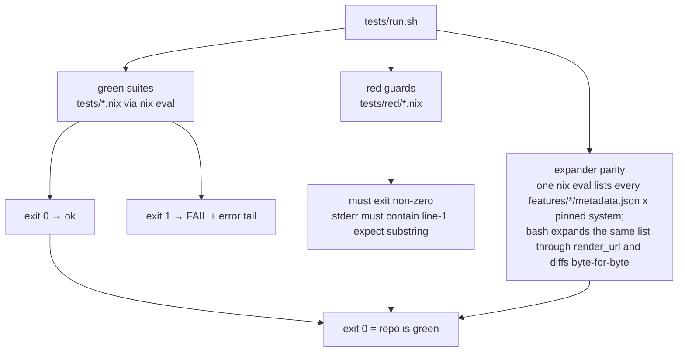
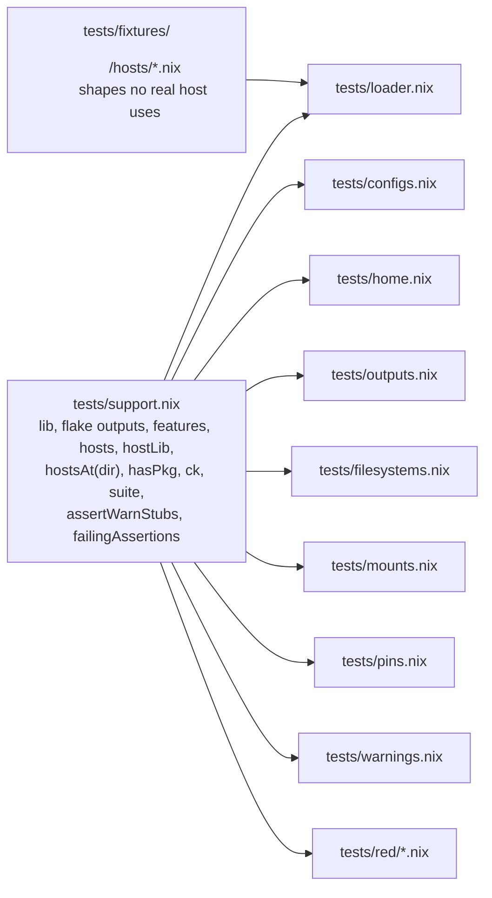
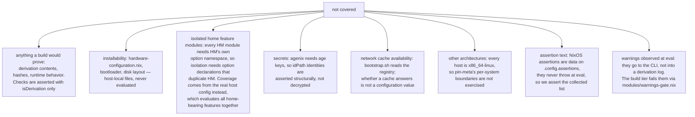

# TEST_DESIGN — eval-only suite

The suite asserts on **evaluated configuration values**, never on built output: `nix eval --impure
--file` forces a config far enough to read option values, and that is the whole cost. No `nix
build` runs, so the gate is fast and works without a store.

## Gate shape

Why two kinds of gate: Nix errors are deferred values, so `builtins.tryEval` cannot catch them.
A guard that must fail is a tiny file whose _exit status_ is the assertion; everything else is a
boolean check inside a suite. Fixture directories exist so loader guards never depend on a real
host changing shape.

Each suite runs in its own process inside a transient systemd scope (`MemoryMax=1792M`, RSS
polled every 40ms). Splitting is not cosmetic: one `nix flake check --no-build` needs ~2.6GB in
a single process (measured), so a single eval would exceed the cap on a RAM-constrained host.
Going over the cap is a failure (exit 137), not a hang. `run.sh` prints each eval's `peak=` on its
line, read from the scope's `MemoryPeak` **while the unit is alive** — systemd drops the unit when
the scope exits, so a peak read afterwards is gone; a killed eval still reports the peak it
reached.

## What each suite covers

```mermaid
flowchart TD
  subgraph loader["loader.nix — pure, ~0.2s"]
    L0["hasPkg contract: pname shape, name shape, a miss,<br/>and a hit that forces nothing after it"]
    L1["feature discovery: features/ dirs == discovered;<br/>hm-* have home.nix; nixos-* have nixos.nix;<br/>overlay-bearing set; resolveFeaturePaths maps each feature to its file"]
    L2["host discovery: names == hosts/; every listed feature resolves;<br/>standalone lists no nixos-*; NixOS hosts carry modules; hmUsernames"]
    L3["fixtures: flat record derives osUsernames/hmUsernames;<br/>directory host auto-discovers nixos.nix + home-*.nix"]
    L4["hostLib: scalar last-wins, list union deduped by first occurrence,<br/>nested attrsets deep, derivation-shaped leaf wins,<br/>profiles merge, mergeHome forces the standalone shape"]
  end
  subgraph configs["configs.nix — forces every NixOS config"]
    C1["per-host facts: hostName, timezone, user shell"]
    C2["universal wiring: tailscale, podman, firefox, printing, wheel"]
    C3["gating: gaming stack only on methyl; gnome/qemu/btrfs only on the VM;<br/>kait2en+fprintd only on the laptop; korthos methyl-only; dms everywhere;<br/>absence read from namespace/systemd-unit/option, never by scanning the package list"]
    C4["cache gate: flakeCache.ready everywhere;<br/>substituters/keys counts == enabled caches"]
  end
  subgraph home["home.nix — forces the standalone HM config"]
    H1["builder facts: username, homeDirectory, genericLinux target"]
    H2["features + packages the profile and the host contribute"]
    H3["nixGL wrapper names"]
  end
  subgraph outputs["outputs.nix — reads the output attrsets"]
    O1["outputs are exactly configs + checks"]
    O2["checks keyed by the system each config was built for"]
    O3["one check per configuration, and each is a derivation"]
    O4["configs derived from host records; host name wired into config.flakeHost"]
  end
  subgraph filesystems["filesystems.nix — pure lib, ~0.2s"]
    F1["mkMounts: entry keys win, entry options REPLACE defaults,<br/>subvol appended last, empty option list dropped"]
    F2["mkUnitMounts: string shorthand, options joined to a comma string,<br/>skipIfMissing -> ConditionPathExists, sugar keys removed"]
    F3["automount whitelist: only where/description/wantedBy/unitConfig/<br/>automountConfig, so mount->automount->mount is not an ordering cycle"]
    F4["joinUnitMounts: groups concatenate in order, [] == {}"]
  end
  subgraph mounts["mounts.nix — forces the 3 hosts enabling nixos-automounts"]
    M1["only those hosts have systemd.automounts; every automount has a<br/>mount at the same where (proves where -> unit-name derivation)"]
    M2["that mount requires and after <unit>.automount;<br/>automounts carry no requires/after/wants and no mountConfig"]
    M3["mounts: mountConfig.TimeoutSec 5, ConditionPathExists shared with the<br/>automount; cifs options carry credentials=/etc/.smb-credentials"]
  end
  subgraph pins["pins.nix — pin metadata contract, ~0.1s"]
    PN1["metadata-backed features discovered; templates use only<br/>the tokens both expanders know ({repo} {version} {arch})"]
    PN2["every pin expands to a resolved url for every pinned system;<br/>a declared arches set covers exactly the hashed systems and is a set, never null"]
    PN3["features/<name>/update.sh is absent or a symlink to lib/updater.sh<br/>the key is quoted — .update.sh would walk update then sh"]
  end
  subgraph warnings["warnings.nix — bare module eval"]
    W1["modules/warnings-gate.nix: assertion true with no warnings,<br/>false with one, and its message carries every warning verbatim"]
  end
```

```mermaid
flowchart LR
  subgraph red["red/*.nix — must throw"]
    R1["unknown feature name"]
    R2["two host files resolving to one name"]
    R3["host file written as a module instead of a record"]
    R4["host file authoring a derived name"]
    R5["mergeHome handed a nixos-* feature"]
    R6["a home configuration has no NixOS system"]
    R7["mkMounts options is a string, not a list"]
    R8["mkUnitMounts options is a string, not a list"]
    R9["mkMounts entry is a string, not an attrset"]
    R10["mkUnitMounts entry is a number, not an attrset"]
    R11["skipIfMissing without what (ConditionPathExists needs the device)"]
    R12["two kernel-pinning features on one host<br/>(boot.kernelPackages would be defined twice)"]
  end
```

Coverage rule: assert on **namespaces and values**, not on `enable` flags. A feature's option
defaults are unreliable evidence — several features ship packages without turning a program
option on — so checks look for the service, the package, or the kernel parameter the feature
actually produces.

Warnings and host assertions are **build-time** signals, and forcing either one evaluates a
host's whole module config (~2.0GB here): `config.assertions` forces `config.warnings`, and
`lib.asserts.checkAssertWarn` throws on failed assertions while printing warnings. So
`modules/warnings-gate.nix` asserts `config.warnings == []` and the build tier (`nix build`,
`nix flake check`, `nixos-rebuild switch`) fails on any warning; no eval suite may force
`config.assertions` or `config.warnings` of a real host. The gate's own logic is covered on a
bare `lib.evalModules` (`tests/warnings.nix`), as is the house warning (`tests/caches.nix`).

## What we do not cover

Deliberately skipped: per-feature coverage of all 39 modules. Feature modules are exercised
through the hosts that enable them — 37 of 39 are enabled by at least one host, so they evaluate
and their effects are asserted. The two no host enables (`hm-dcal`, `nixos-zram`) have no test: a
feature no host asks for is not a shipping contract. If one of them becomes load-bearing, cover it
by enabling it on a fixture host, not by isolating the module. Kernel choice is the exception:
`nixos-cachyos` and `nixos-kait2en` both write `boot.kernelPackages`, so listing both on one host
is an authoring error — `lib/features.nix` throws on it (`tests/red/kernel-feature-collision.nix`)
and `tests/configs.nix` asserts which kernel each host boots.
