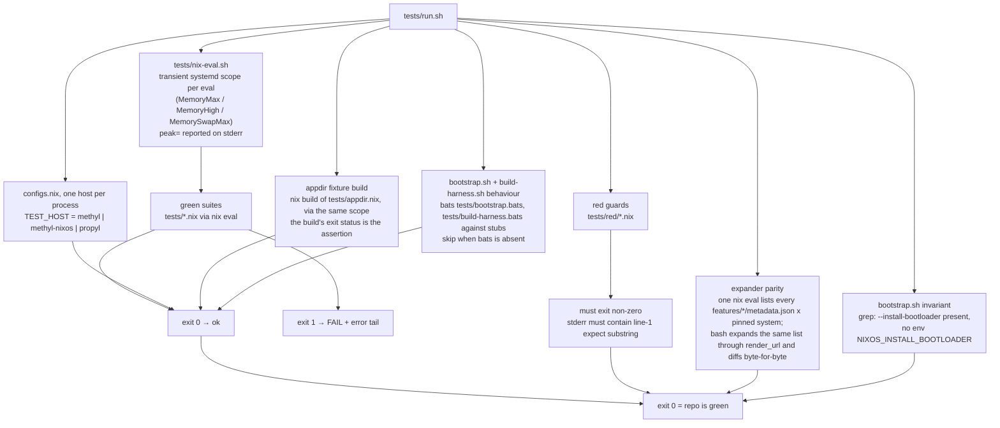
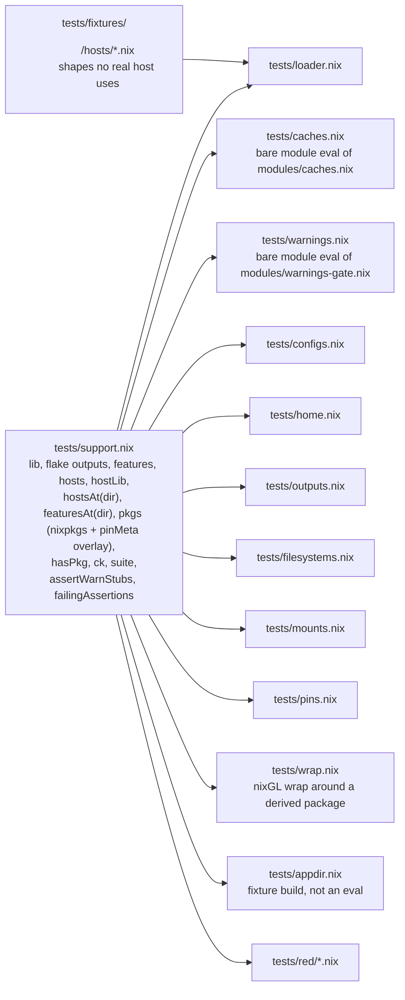
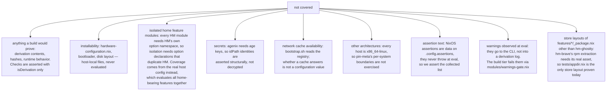

# TEST_DESIGN — eval-only suite

The suite asserts on **evaluated configuration values**, never on built output: `nix eval --impure
--file` forces a config far enough to read option values, and that is the whole cost. No real
`nix build` runs, so the gate is fast and works without a store. The one exception is
`tests/appdir.nix`: a fixture build that re-runs a derivation's own `installPhase` against a
synthetic tree, downloading nothing.

## Gate shape



Style is outside the gate: `statix check .` and `alejandra --check .` are run by hand (or CI), not
by `tests/run.sh`.

One suite is not an eval: `tests/bootstrap.bats` asserts the behaviour of `bootstrap.sh` — which
installer flags it picks (`install ostree --enable-flakes --persistence <dir>`), which switch command
it picks for `host` against `user@host`, the flags it refuses, the trusted-user gate and the trust
step's post-check, and the memory-scope probe falling back when `systemd-run` cannot run. Those are
argv and exit codes, not evaluated Nix values, so the suite runs the script against PATH stubs as an
ordinary user: no root, no real `/nix`, no real `curl`, no eval. It costs ~0MB, which is why it is
bash rather than another scoped eval. `bats` comes from the installed Nix profile, so a missing `bats`
is a `skip`, not a failure.



Why two kinds of gate: Nix errors are deferred values, so `builtins.tryEval` cannot catch them.
A guard that must fail is a tiny file whose _exit status_ is the assertion; everything else is a
boolean check inside a suite. Fixture directories exist so loader guards never depend on a real
host changing shape.

Each suite runs in its own process inside a transient systemd scope (`MemoryMax`, `MemoryHigh` at
90% of it, `MemorySwapMax` at half of it; RSS polled every 20ms — systemd only reports
`MemoryPeak` while the unit is alive, so a peak read after the scope exits is gone). Swap is
_capped_, not forbidden: with `MemorySwapMax=0` an allocation that cannot be met from free RAM
stalls instead of being killed, and the gate hung on this box.

Splitting is not cosmetic: forcing three host configs in one eval peaks at ~2.1GB, and a single
`nix flake check --no-build` needs ~2.6GB (measured), both over the 1792MB cap — hence
`configs.nix` runs one host per process. Going over the cap is a failure (exit 137), not a hang.
`run.sh` prints each eval's `peak=` on its line. Measured today: the whole gate ~27s, largest
per-eval peak ~793MB (`tests/home.nix`, the standalone profile, which forces its Home Manager
users), `wrap` ~733MB, host configs ~670–695MB, pure suites under 40MB, and the appdir fixture
build ~88MB with no download.

## Build telemetry, outside the gate

`tests/build-harness.sh` measures one attribute — how much RAM it needs and how long it takes under
a cap — and is deliberately **not** part of `tests/run.sh`: the gate never runs a real build, and
this harness does. It wraps the attribute in the same transient scope `tests/nix-eval.sh` provides
and prints one telemetry line — `mode` (eval or build), `attr`, `cap`, `peak`, `swap`, `wall`,
`exit` — then the client's own output. Exit code is the client's.

- `peak`/`swap` are the scope's `MemoryPeak`/`MemorySwapPeak`, read while the unit is alive. That is
  the only authoritative number for a Nix eval (DESIGN.md, "Build RAM"): `NIX_SHOW_STATS` and
  `/usr/bin/time -v` both under-report it, so `--stats` is for thunk and attrset counts, never RAM.
- `wall` is the whole scoped run, so a run killed at the cap reports the time it took to die.
- `--build` realises instead, and reports `out=` plus the recursive NAR size (`nix path-info -Ssh`).
  Realisation runs in the root `nix-daemon`, outside the scope, so `peak` is the **client's** memory
  — eval — not the machine's total.
- It runs exactly what `features/hm-njust/nix.just` runs: `nix build --no-link --dry-run` for
  `njust eval`, `nix build --out-link` for `njust build`. Extra arguments after the attribute reach
  `nix build` verbatim.
- Rebuild telemetry (`nixos-rebuild`, `home-manager switch`) is `bootstrap.sh`'s own scope; wrap any
  other command with `tests/nix-eval.sh <cap> -- <cmd>`.
- Overrides: `BUILD_HARNESS_MEM` (cap, default 3072), `BUILD_HARNESS_LINK`.

Its own logic is gated without building anything: `tests/build-harness.bats` drives the harness
against a PATH stub and asserts the command mapping, the telemetry fields, and the refusals (~0MB).
Measuring every prospective host is four runs of one interface — **sequentially**, because two
scoped runs side by side contaminate each other's peak:

```bash
bash tests/build-harness.sh -- '.#nixosConfigurations.methyl.config.system.build.toplevel'
bash tests/build-harness.sh -- '.#nixosConfigurations.methyl-nixos.config.system.build.toplevel'
bash tests/build-harness.sh -- '.#nixosConfigurations.propyl.config.system.build.toplevel'
bash tests/build-harness.sh -- '.#homeConfigurations.josh@methyl-bazzite.activationPackage'
```

## What each suite covers

```mermaid
flowchart TD
  subgraph loader["loader.nix — pure, ~0.2s"]
    L0["hasPkg contract: pname shape, name shape, a miss,<br/>and a hit that forces nothing after it"]
    L1["feature discovery: features/ dirs == discovered;<br/>hm-* have home.nix; nixos-* have nixos.nix;<br/>overlay-bearing set; resolveFeaturePaths maps each feature to its file;<br/>a symlinked feature dir is discovered"]
    L2["host discovery: names == hosts/; every listed feature resolves;<br/>standalone lists no nixos-*; NixOS hosts carry modules; hmUsernames;<br/>adminUsernames derives from isAdmin on enabled users"]
    L3["fixtures: flat record derives osUsernames/hmUsernames;<br/>directory host auto-discovers nixos.nix + home-*.nix;<br/>symlinked nixos.nix/home-*.nix are discovered;<br/>a declared homeModules.<user> keeps the discovered home-<user>.nix"]
    L4["hostLib: scalar last-wins, list union deduped by first occurrence,<br/>nested attrsets deep, derivation-shaped leaf wins,<br/>profiles merge, mergeHome forces the standalone shape"]
  end
  subgraph configs["configs.nix — forces every NixOS config"]
    C1["per-host facts: hostName, timezone, user shell"]
    C2["universal wiring: tailscale, podman, firefox, printing, wheel"]
    C3["gating: gaming stack only on methyl; gnome/qemu/btrfs only on methyl-nixos;<br/>kait2en+fprintd only on propyl; korthos methyl-only; dms everywhere;<br/>absence read from namespace/systemd-unit/option, never by scanning the package list;<br/>the positive side of every absence signal is asserted too, so absence is not vacuous"]
    C4["cache gate: flakeCache.ready everywhere;<br/>substituters/keys counts == enabled caches;<br/>the caches each host's features actually require (nix-community, kait2en,<br/>wombatfromhell only where niri-spicy is on)"]
    C5["kernel: which kernel each host boots, incl. the kait2en kernel<br/>the feature pins rather than boot.kernelPackages"]
    C6["nixGL disabled: packages null for josh, which is what makes lib.nixGL.wrapGpu<br/>identity; the GUI features hand their pinned pname+version to the program options<br/>(identity by name, not outPath — forcing outPath pulls Brave's whole dependency<br/>closure, ~470MB per host); the PATH-once half lives in wrap/home,<br/>because counting home.packages forces every package name"]
  end
  subgraph home["home.nix — forces the standalone HM config"]
    H1["builder facts: username, homeDirectory, genericLinux target"]
    H2["features + packages the profile and the host contribute;<br/>hm-base ships packages, not program flags"]
    H3["nixGL wrapper names; packages set on this non-NixOS host;<br/>the host uses the default wrapper (mesa); the GUI derivations are wrapped<br/>(outPath differs from _package.nix's) and each lands on PATH exactly once"]
  end
  subgraph outputs["outputs.nix — reads the output attrsets"]
    O1["outputs are exactly configs + checks"]
    O2["checks keyed by the system each config was built for"]
    O3["one check per configuration, and each is a derivation"]
    O4["configs derived from host records; host name wired into config.flakeHost"]
  end
  subgraph caches["caches.nix — bare module eval of modules/caches.nix"]
    CA1["a required cache the host does not enable is warned by name,<br/>including the fix line; an enabled one warns nothing"]
    CA2["ready false while a required cache is disabled, true when enabled or when nothing is required"]
    CA3["a required cache outside the registry fails an assertion"]
    CA4["substituters and keys come from the enabled caches in order; [] means none"]
  end
  subgraph filesystems["filesystems.nix — pure lib, ~0.2s"]
    F1["mkMounts: entry keys win, entry options REPLACE defaults,<br/>subvol appended last, empty option list dropped"]
    F2["mkUnitMounts: string shorthand, options joined to a comma string,<br/>skipIfMissing -> ConditionPathExists, sugar keys removed"]
    F3["automount whitelist: only where/description/wantedBy/unitConfig/<br/>automountConfig, so mount->automount->mount is not an ordering cycle"]
    F4["joinUnitMounts: groups concatenate in order, [] == {}"]
  end
  subgraph mounts["mounts.nix — forces the 3 hosts enabling nixos-automounts"]
    M1["only those hosts have systemd.automounts; every automount has a<br/>mount at the same where (proves where -> unit-name derivation)"]
    M2["that mount requires and after <unit>.automount;<br/>automounts carry no requires/after/wants and no mountConfig;<br/>automounts are wanted by multi-user.target"]
    M3["mounts: mountConfig.TimeoutSec 5, ConditionPathExists shared with the<br/>automount; cifs options carry credentials=/etc/.smb-credentials"]
  end
  subgraph pins["pins.nix — pin metadata contract, ~0.1s"]
    PN1["metadata-backed features discovered; templates use only<br/>the tokens both expanders know ({repo} {version} {arch})"]
    PN2["every pin expands to a resolved url for every pinned system;<br/>a declared arches set covers exactly the hashed systems and is a set, never null"]
    PN3["features/<name>/update.sh is absent or a symlink to lib/updater.sh<br/>the key is quoted — .update.sh would walk update then sh"]
  end
  subgraph wrap["wrap.nix — nixGL around derived packages, ~3s, peak ~925MB"]
    WR1["three fixture Home Manager configs over typed host facts: a NixOS side, a<br/>standalone side with the default wrapper, and a standalone side setting<br/>features.nixgl.wrapper = nvidiaPrime (hm-nixgl, hm-brave, hm-zed, hm-ghostty in all three).<br/>hm-nixgl sets packages only on the non-NixOS side; wrapGpu is identity there and returns<br/>a distinct derivation here, and delegates to Home Manager's own lib.nixGL.wrap; defaultWrapper<br/>follows the host's option (mesa on both default sides, nvidiaPrime when set) — the Nvidia<br/>wrapper itself cannot be forced here, because nixGL's Nvidia wrapper reads the host driver<br/>version and gets null. pname and version survive the wrap; programs.chromium's<br/>commandLineArgs branch fires on both sides and the overridden package keeps its<br/>pname/version, and wrapGpu stays identity on the overridden derivation on the NixOS side<br/>(the branch is an option value, so it is asserted as one rather than by forcing Home<br/>Manager's chromium override chain); each package reaches home.packages exactly once;<br/>brave's .drv wraps its bin entries only when commandLineArgs are set;<br/>the wrapped Ghostty still links the AppDir (`cp -rs`) and execs its launcher through<br/>nixGL's combined wrapper, so its /proc/self/exe AppDir resolution survives the wrap"]
  end
  subgraph appdir["appdir.nix — fixture build, ~8s, peak ~83MB"]
    AD1["features/hm-ghostty/_package.nix's real installPhase against a synthetic AppDir:<br/>bin/ghostty kept and executable, AppRun / sharun / dash / .env / .DirIcon and<br/>bin/*.hook dropped, desktop entry and icon moved into share/ not copied,<br/>and the resource trees left alone"]
  end
  subgraph warnings["warnings.nix — bare module eval"]
    W1["modules/warnings-gate.nix: assertion true with no warnings,<br/>false with one, and its message carries every warning verbatim"]
  end
```

```mermaid
flowchart LR
  subgraph red["red/*.nix — must throw"]
    R1["unknown feature name"]
    R2["two host files resolving to one name"]
    R3["host file written as a module instead of a record"]
    R4["host file authoring a derived name"]
    R5["mergeHome handed a nixos-* feature"]
    R6["a home configuration has no NixOS system"]
    R7["mkMounts options is a string, not a list"]
    R8["mkUnitMounts options is a string, not a list"]
    R9["mkMounts entry is a string, not an attrset"]
    R10["mkUnitMounts entry is a number, not an attrset"]
    R11["skipIfMissing without what (ConditionPathExists needs the device)"]
    R12["two kernel-pinning features on one host<br/>(boot.kernelPackages would be defined twice)"]
    R13["features.nixgl.wrapper outside Home Manager's wrapper enum<br/>(the wrong driver set is a runtime failure, not an eval one)"]
  end
```





Coverage rule: assert on **namespaces and values**, not on `enable` flags. A feature's option
defaults are unreliable evidence — several features ship packages without turning a program
option on — so checks look for the service, the package, or the kernel parameter the feature
actually produces.

Warnings and host assertions are **build-time** signals, and forcing either one evaluates a
host's whole module config (~2.0GB here): `config.assertions` forces `config.warnings`, and
`lib.asserts.checkAssertWarn` throws on failed assertions while printing warnings. So
`modules/warnings-gate.nix` asserts `config.warnings == []` and the build tier (`nix build`,
`nix flake check`, `nixos-rebuild switch`) fails on any warning; no eval suite may force
`config.assertions` or `config.warnings` of a real host. The gate's own logic is covered on a
bare `lib.evalModules` (`tests/warnings.nix`), as is the house warning (`tests/caches.nix`).

## What we do not cover



The seven `features/*/_package.nix` derivations are covered on their **input** side by
`tests/pins.nix` (pin metadata expands to a resolved URL for every pinned system) and by
`tests/run.sh` diffing the bash and Nix URL expanders byte-for-byte. What a derivation then does
with that asset is build-tier: `tests/appdir.nix` proves hm-ghostty's relocation by re-running its
installPhase over a synthetic AppDir, and the wrap is proven at eval by `tests/wrap.nix`. The
others unpack real vendor assets (rpm, tarballs), so a fixture could not stand in for them.

Deliberately skipped: per-feature coverage of all 39 modules. Feature modules are exercised
through the hosts that enable them — 37 of 39 are enabled by at least one host (`nixos-zram` is
commented out in `hosts/methyl-base/base.nix`, `hm-dcal` is listed nowhere), so they evaluate
and their effects are asserted. The two no host enables have no test: a feature no host asks for
is not a shipping contract. If one of them becomes load-bearing, cover it by enabling it on a
fixture host, not by isolating the module. Kernel choice is the exception:
`nixos-cachyos` and `nixos-kait2en` both write `boot.kernelPackages`, so listing both on one host
is an authoring error — `lib/features.nix` throws on it (`tests/red/kernel-feature-collision.nix`)
and `tests/configs.nix` asserts which kernel each host boots.
